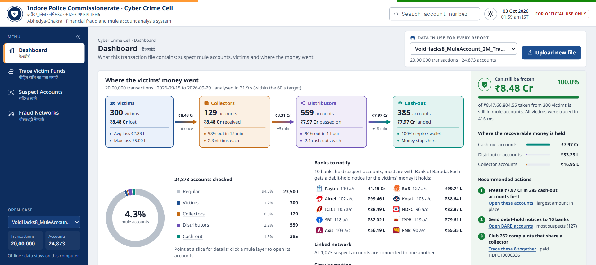
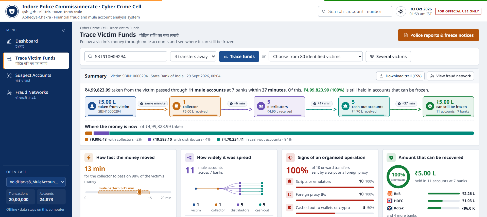
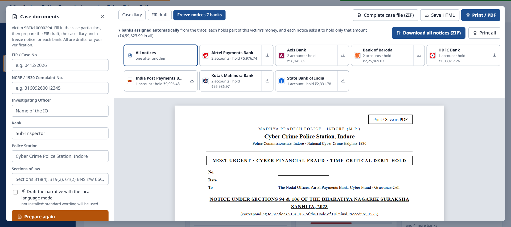
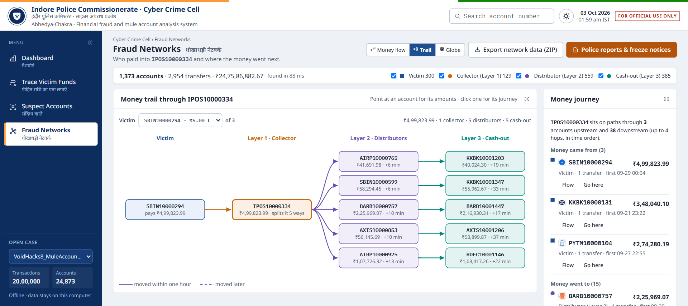
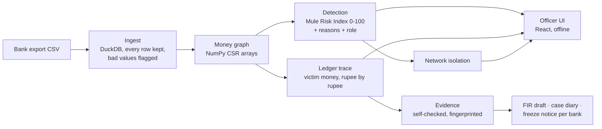

# Abhedya-Chakra

[](https://github.com/VoidHacks-8-O/Srijan-Coders/actions/workflows/ci.yml)

**Money-mule detection, tracing and freeze engine for the Indore Police Cyber Crime Cell (1930 helpline).**
Void Hacks 8.0 finale · Team Srijan-Coders.

When a victim reports a cyber fraud, the money has usually moved through several mule accounts within minutes.
Abhedya-Chakra loads the bank transaction export, scores every account for mule behaviour, follows the victim's
money rupee by rupee to every account that received it, shows how much can still be frozen and where, and drafts
the FIR, the case diary and one debit-hold notice per bank. It runs entirely offline on one laptop: no data
leaves the machine.



## What an officer can do

| Screen | What it answers |
|---|---|
| **Dashboard** | Where all victims' money went (victims → collectors → distributors → cash-out), how much can still be frozen and in which banks, three recommended actions, and the dataset in use (upload a new bank export from here). |
| **Trace Victim Funds** | For one complainant: every account that received their money, layer by layer, with exact amounts and times; a replay of the money moving; what the first mule did with it, payment by payment; the accounts to freeze. **Several victims** traces up to 20 complainants at once and names the mule accounts they share, so complaints can be clubbed. |
| **Suspect Accounts** | Every flagged account with its role and its reasons in plain words, and *how the score was reached*, check by check. |
| **Fraud Networks** | The syndicate around any account: the money flow around it, one victim's trail through it, or the whole network as a 3D globe; export of the original rows as a ZIP. |
| **Police reports & freeze notices** | FIR draft (Section 173 BNSS), case diary (Section 192 BNSS), and a debit-hold notice under Sections 94 & 106 BNSS for every bank that holds the victim's money, assigned automatically, exportable one by one or as one ZIP, plus the complete case file. |

| Trace of one victim | Freeze notices, one per bank |
|---|---|
|  |  |



## Quick start

Requirements: Python 3.12, Node.js 20+ (only to build the UI once), Windows, Linux or macOS.

**Windows, one click:** run `start_server.bat`. It installs the Python packages the first time, starts the engine
on the official file (or `data/sample.csv` if the official file is not present) and opens the browser.

**By hand:**

```bash
python -m venv .venv && .venv\Scripts\activate          # Linux/macOS: source .venv/bin/activate
pip install -e .
cd web && npm install && npm run build && cd ..          # build the UI once
python -m abhedya serve --data data/VoidHacks8_MuleAccount_2M_Transactions.csv
```

Open <http://127.0.0.1:8000>. `serve --data` analyses the file first if it has not been analysed yet (checked by
SHA-256), then serves. The CSV is treated as evidence: it is only ever read, never modified.

| Command | What it does |
|---|---|
| `python -m abhedya ingest --data <csv>` | load, validate, index and score a file without serving |
| `python -m abhedya serve` | serve the last analysed case |
| `python -m pytest` | all tests (`pip install -e .[dev]`; the browser workflows also need `pip install playwright` and Microsoft Edge) |
| `python bench/run.py` | performance benchmarks on the 2M file → `bench/results.md` |
| `python -m eval.evaluate` | accuracy on the official file → `eval/report.md` |

## How it works



- **Ingest** (`abhedya/ingest/`): a tolerant reader built on DuckDB. Every row is kept; malformed values are flagged
  with data-quality codes and kept out of the money graph instead of crashing the load.
- **Detection** (`abhedya/detect/`): four named checks (passes money on within 3-15 minutes; splits, gathers or
  circles money; cash-out channel, script device or foreign proxy IP; money from or to other suspects) combined so
  overlapping evidence is not counted twice, plus minimum scores for the patterns the problem statement names
  outright. Accounts at 70 or more are flagged; every flag carries its reasons, and the panel shows each check's points.
- **Trace** (`abhedya/graph/trace.py`): replays each account's ledger in time order. A payment out is matched first
  to money that arrived 3 to 15 minutes earlier, then to a credit it passes on at 90 % or more, otherwise the
  holder's own money is spent first. Every paisa is accounted for, so the amount still held in each account is
  exact, separated from the mule's other money.
- **Network** (`abhedya/graph/ring.py`, `abhedya/graph/flow.py`): the connected group of suspects around an
  account, and a case-wide summary from tracing every identified victim (about 0.3 s for all 300).
- **Documents** (`abhedya/evidence/`, `abhedya/docs/`): every account, IFSC, transaction ID and amount is inserted
  from the evidence; an output firewall checks each document against the data and blocks release if a single
  value cannot be verified. Every document carries the data's SHA-256 and a facts fingerprint.
- **Optional AI narrative** (`abhedya/ai/`): a local model through [Ollama](https://ollama.com)
  (`ollama pull qwen2.5:3b`) can draft the case diary's narrative. It sees only evidence IDs and facts, never raw
  narrations; its reply is validated (no number, account or date it was not given) and falls back to fixed
  templates. Detection and tracing never use it.

Full technical walkthrough: [`docs/HOW_IT_WORKS.md`](docs/HOW_IT_WORKS.md). Team and demo guide:
[`docs/TEAM_GUIDE.md`](docs/TEAM_GUIDE.md). Design system: [`DESIGN.md`](DESIGN.md).

## Results

Measured on a laptop with an Intel i5-10300H and 16 GB RAM, on the official file (2,000,000 transactions,
24,873 accounts). Sources: `bench/results.md`, `eval/report.md`, `reports/final_test_matrix.md`.

| Requirement | Result |
|---|---|
| Ingest, index and score 2M transactions in ≤ 60 s | **26.7 s** (median of 5 runs; peak memory 1.4 GB) |
| Mule detection on the official file | **precision 1.000, recall 1.000** (1,073 mules: 129 collectors, 559 distributors, 385 cash-out; 0 false positives among 23,500 regular accounts) |
| Blind victim trace, exact L1 / L2 / L3 | **300 / 300 victims exact** |
| 4-hop victim trace in ≤ 2 s | **3.7 ms** median, 11 ms worst (5.3 ms over the web API) |
| Full investigation (trace, accounts, network, documents) | about 0.5 s per victim |

On independently generated data (laundering patterns from published typologies, never the official file),
the engine finds 91.5-91.9 % of clear-cut mules with 4 false positives among 18,839 legitimate accounts
(`reports/final_readiness_report.md`, `reports/adversarial/`).

## Tech stack

| Layer | Technology |
|---|---|
| Data and storage | DuckDB, NumPy (CSR graph arrays) |
| Engine and API | Python 3.12, FastAPI, Uvicorn, Pydantic |
| Documents | Jinja2 templates, output firewall, SHA-256 manifests |
| Optional AI narrative | Ollama with qwen2.5:3b (local), validator, template fallback |
| Web UI | React 19, TypeScript 6, Vite 8, D3, SVG views, react-force-graph-3d |
| Quality | pytest + Playwright browser workflows, ruff, oxlint, TypeScript strict, GitHub Actions CI |

An optional machine-learning scorer (LightGBM and XGBoost stacked with the rules, trained on generated data) is kept
on the [`previous-main`](https://github.com/VoidHacks-8-O/Srijan-Coders/tree/previous-main) branch
(`mule-engine/`). The workstation itself detects with the explainable rules above.

## Project layout

```
abhedya/          engine: ingest, graph, detect, trace, network, evidence, documents, AI narrative, API
contracts/        Pydantic models shared by the engine, the API and the UI (checked field by field by a test)
web/              officer UI (React + TypeScript)
tests/            unit, API, document, security, robustness and browser-workflow tests
eval/             accuracy evaluation against the official file's ground truth
bench/            performance and AI-model benchmarks
reports/          test matrix, readiness report, adversarial results
docs/             technical walkthrough, team guide, screenshots
data/sample.csv   a 50,000-row sample of the official file, used by the tests
```

## Quality

- **Tests:** 228 automated tests: ingest edge cases, every trace rule, the 300 official victims, API contract,
  documents and the output firewall, path-traversal and upload security, and browser workflows that drive the real UI
  in headless Microsoft Edge.
- **Continuous integration:** every push runs ruff and pytest for the engine, and oxlint, the TypeScript check and
  the production build for the UI.
- **Evidence handling:** the input file is hashed before and after every run and never written to; every document
  and export carries the data's SHA-256.

## Limitations

- Detection is tuned to the patterns in the problem statement; on other banks' data the rules should be reviewed,
  and the measured recall on independent data is about 92 %, not 100 %.
- Performance was measured on a 16 GB laptop; smaller machines have not been tested.
- The FIR, case diary and notices are **draft formats for the officer's verification**, not official templates.

## Team Srijan-Coders

Kartikey Yadav · Sarthak Malakar · Vaishnavi Khatri · Kshitiz Kumar

Contributor guide: [`CONTRIBUTING.md`](CONTRIBUTING.md).
