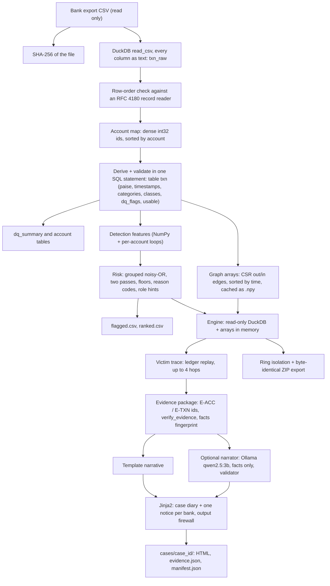

# How Abhedya-Chakra works

This document explains the engine from the moment a bank export CSV is opened to the moment a case diary and bank
notices are written. It is written for our team and for technical mentors who know Python, SQL and graphs but have not
read this codebase.

Conventions used below:

- Paths are relative to the repository root. Code identifiers are in backticks with the file that defines them.
- Money is always integer **paise** inside the engine (1 rupee = 100 paise). Rupees appear only in rendered documents.
- Parameter values (windows, weights, thresholds) are quoted exactly as they stand in `abhedya/config.py` and
  `abhedya/detect/params.py`.
- Measured figures are quoted only from `bench/results.md`, `eval/report.md`, `bench/llm_results.md`,
  `reports/final_readiness_report.md` and `reports/final_test_matrix.md`, and each one names its source.

## Contents

1. [Overview and pipeline](#1-overview-and-pipeline)
2. [Technology stack](#2-technology-stack)
3. [Ingest: from CSV to validated tables](#3-ingest-from-csv-to-validated-tables)
4. [Graph: CSR arrays](#4-graph-csr-arrays)
5. [Detection: features and the Mule Risk Index](#5-detection-features-and-the-mule-risk-index)
6. [Victim trace: ledger-replay attribution](#6-victim-trace-ledger-replay-attribution)
7. [Ring isolation and export](#7-ring-isolation-and-export)
8. [Evidence and documents](#8-evidence-and-documents)
9. [AI narrator](#9-ai-narrator)
10. [API, engine model and UI](#10-api-engine-model-and-ui)
11. [Testing and verification](#11-testing-and-verification)
12. [Measured results and limitations](#12-measured-results-and-limitations)
13. [Glossary](#13-glossary)

---

## 1. Overview and pipeline

Abhedya-Chakra is an offline investigation workstation. `python -m abhedya serve --data <csv>` reads a bank
transaction export into a local DuckDB database without changing the file, parses and flags every value, builds
compressed adjacency arrays of the money graph, and scores every account for mule risk (0-100, with reason codes).
It then serves a local web app on 127.0.0.1. From a victim account ID, the engine follows the victim's money forward
in time through at most 4 hops. It attributes every paisa to the transfer that moved it, isolates the surrounding
syndicate, and renders a police case diary plus one Sections 94 & 106 BNSS (91 & 102 CrPC) notice per bank. Every
account number, IFSC, transaction ID and rupee figure in those documents is inserted from a checked evidence package.
An optional local language model may write three prose paragraphs, but it never sees or produces a fact.



Plain-text version of the same pipeline:

1. Hash the CSV (SHA-256).
2. Load it into DuckDB with every field as text (`txn_raw`).
3. Check that the database row order equals the file's record order.
4. Assign each account a dense integer id.
5. Parse amounts, timestamps and categories, attach data-quality flags, and mark which rows can move money (`txn`).
6. Write the data-quality summary and the per-account table.
7. Build CSR adjacency arrays (outgoing and incoming) and cache them on disk.
8. Compute detection features and the risk score for every account; write `features`, `risk` and CSV exports.
9. Serve: load the arrays and a read-only database connection; answer trace, ring, account and document requests.
10. For documents: trace, build the evidence package, check it, optionally draft prose with the local model,
    validate the prose, render HTML through Jinja2, scan the HTML with the output firewall, write files and hashes.

---

## 2. Technology stack

| Component | Technology | Why it was chosen |
|---|---|---|
| Storage and SQL | **DuckDB** (in-process, single file `data/case.duckdb`) | Columnar, multi-threaded CSV reader that can read every field as text and record rejected lines. SQL with `TRY_CAST` lets us parse safely without dropping rows. No server to install. The problem statement names DuckDB as a suitable engine. `fetchnumpy()` hands columns straight to NumPy. |
| Graph and features | **NumPy** | Typed arrays (`int32`, `int64`, `uint8`) for a compact CSR graph. `lexsort`, `searchsorted`, `bincount` and `add.at` compute most features as whole-array operations. `.npy` files load fast in a new process. |
| Algorithms | Python 3.12 standard library: `heapq`, `bisect`, `csv`, `hashlib`, `zipfile` | The trace needs a global event queue (`heapq`) and the features need sorted-time window search (`bisect`). The rest is plain, auditable Python. |
| HTTP API | **FastAPI** on **uvicorn** (1 worker, 127.0.0.1) | Typed routes with pydantic response models and query-parameter validation. Synchronous handlers run in FastAPI's thread pool, so one process serves the UI and the API. |
| Data contracts | **pydantic** v2 (`contracts/models.py`) | One definition of every object crossing a boundary (engine, API, UI, documents, model output). It also generates the JSON schema that constrains the language model, and validates its reply. |
| Serialisation | **orjson** | Fast JSON. `OPT_SORT_KEYS` gives a canonical byte form, so SHA-256 fingerprints of evidence and traces are reproducible. Used for the audit log and manifests. |
| Documents | **Jinja2** | HTML templates with autoescaping on and `StrictUndefined` (a missing value is an error, never an empty string). A custom `inr` filter is the only way a rupee figure enters a document. |
| Model client | **httpx** | Separate connect and read timeouts, so a stopped model falls back to templates quickly. |
| Optional narrator | **Ollama** serving **qwen2.5:3b** on 127.0.0.1:11434 | Runs locally, so nothing leaves the machine. Ollama accepts a JSON schema as the output `format`, which bounds what the model can emit. A small model is enough because it only writes three short paragraphs. |
| Benchmark support | **psutil** | Peak process memory for `bench/run.py`. |
| User interface | **React 19 + Vite 8 + TypeScript 6** (`web/`) | The trace tree (also used for the network's trail view) is plain SVG with a fixed left-to-right layout, so there is no physics simulation; the optional globe uses react-force-graph-3d for the whole official ring (1,373 accounts in the browser workflow, `reports/final_readiness_report.md`). Vite builds static files that FastAPI serves, so the UI needs no internet. TypeScript types mirror the pydantic models and are checked by a contract test. |
| Tests | **pytest**, **Hypothesis** (property tests), **Playwright** driving headless Microsoft Edge | Unit, adversarial and property tests in Python; real browser workflows against the real API. |

---

## 3. Ingest: from CSV to validated tables

Entry point: `run_ingest()` in `abhedya/ingest/pipeline.py`, called by `python -m abhedya ingest --data <csv>` or
automatically by `serve --data <csv>` (see section 10.4).

### 3.1 Stages and timings

`run_ingest` deletes any previous database file (and its WAL), opens a new DuckDB connection, and runs these stages.
Each one is timed with `time.perf_counter()` and printed. The per-stage times are stored in the `meta` table and in
the manifest.

| Stage name | Function | What it does | Median on 2,000,000 rows (`bench/results.md`) |
|---|---|---|---|
| `hash` | `audit.log.sha256_file` | SHA-256 of the input file, read in 8 MiB chunks | 0.62 s |
| `load_csv` | `ingest/load.py::load_raw` | Tolerant DuckDB read into `txn_raw` | 5.04 s |
| `verify_order` | `ingest/load.py::verify_row_order` | Database row order = file record order | 0.01 s |
| `account_map` | `ingest/load.py::build_account_map` | Dense integer id per account | 0.30 s |
| `derive+validate` | `ingest/derive.py::build_txn` | Parsed values, categories, flags, `usable` | 4.86 s |
| `dq_summary` | `ingest/validate.py::write_dq_summary` | Count of rows per flag | 0.01 s |
| `account_table` | `ingest/derive.py::build_account` | Per-account totals, bank name, first/last time | 0.15 s |
| `graph_arrays` | `graph/build.py::build_arrays` | CSR arrays written to `.npy` | 1.34 s |

Ingest plus index, all stages: median **12.65 s** (min 12.12, max 12.71) over 5 fresh processes, peak memory
1,380 MB, against a 60 s budget (`bench/results.md`). After `account_table`, the temporary tables `txn_raw` and
`acct_map` are dropped. Detection then runs (section 5) unless `--skip-detect` is given.

### 3.2 Tolerant read: every field as text

`load_raw()` builds a `read_csv` call with these options:

```
header = true, delim = ',', quote = '"', escape = '"',
all_varchar = true, null_padding = true, strict_mode = false, store_rejects = true
```

- `all_varchar = true`: nothing is typed at read time. A malformed amount or timestamp cannot abort the load or be
  silently coerced. Parsing happens later with `TRY_CAST` (section 3.6).
- `null_padding = true`: a short row gets NULLs for its missing fields instead of being rejected.
- `store_rejects = true`: any line DuckDB still cannot read is recorded in its `reject_errors` table. The count is
  returned as `rejects` and written to the manifest.
- `SET preserve_insertion_order = true` keeps DuckDB's `rowid` equal to the order of records in the file. That
  `rowid` becomes `txn_idx`, the real primary key. `Transaction_ID` cannot be the key, because it is not unique in the
  official file.

An empty file raises `IngestError` with a plain message. So does a file DuckDB cannot read as CSV at all.

### 3.3 Column matching

The reader first runs `DESCRIBE SELECT * FROM read_csv(...)` to get the header. Names are matched to the 11 required
columns (`REQUIRED_COLUMNS` in `ingest/load.py`) case-insensitively, after stripping whitespace and a UTF-8 byte-order
mark. Then:

- If any required column is missing, ingest stops with an `IngestError` that lists the missing and the found columns.
- Extra columns are ignored, and their names are recorded as `extra_columns_ignored` in the manifest.
- Columns are selected by name and aliased to the canonical names, so a file with reordered columns loads the same.

### 3.4 Row-order verification (RFC 4180 record reader)

Every later step relies on `txn_idx` meaning "the N-th data record of the file". The ring export (section 7) uses it
to copy the original bytes of a record. `verify_row_order()` checks this against an independent reader,
`iter_records()` in `abhedya/ingest/records.py`:

- `iter_records()` reads the file as bytes and yields each data record's raw bytes, including its line ending. The
  header and empty lines are skipped, as DuckDB skips them.
- A line without any `"` byte always ends a record (fast path). Otherwise `_still_quoted()` runs a small RFC 4180
  state machine. A quote opens a quoted value only at the start of a field. Inside a quoted value, `""` is a literal
  quote and a single `"` closes it. A stray quote in the middle of an unquoted field is plain text. If the line ends
  inside a quoted value, the record continues on the next line.
- The check compares the `Transaction_ID` of the first 1,000 records (`n_head = 1000`) from DuckDB with the same
  field from `iter_records()`. Then it compares the last record. The fast path reads the last 64 KiB of the file and
  takes the last non-empty physical line. If that does not match (for example, a last record spanning several lines),
  it walks all records.
- Any mismatch raises `RuntimeError` and ingest stops.

### 3.5 Account map

`build_account_map()` takes every non-NULL account from both the sender and the receiver columns. Per account it keeps
`min(ifsc)` and `n_ifsc` (the number of distinct IFSCs seen with it, which records an inconsistency without hiding
it). It assigns `acct_id = row_number() OVER (ORDER BY account) - 1`. The ids are therefore dense `int32` values
ordered by the account string. Section 4 uses that order for prefix search.

### 3.6 Derived columns

`build_txn()` creates table `txn` in one `CREATE TABLE ... AS` statement. Every raw value is kept next to its derived
value. Every row of `txn_raw` appears in `txn`: the joins to the account map are `LEFT JOIN`s, so a row is never
dropped.

| Column | Rule (from `ingest/derive.py`, constants from `config.py`) |
|---|---|
| `txn_idx` | `rowid` of `txn_raw` (0-based record number in the file) |
| `amount_paise` | `TRY_CAST(replace(trim(Amount), ',', '') AS DECIMAL(18,2))`, multiplied by 100 and cast to `BIGINT`. Exact decimal arithmetic, never a float. NULL if the text is not a number. Raw text kept in `amount_raw`. |
| `ts`, `ts_epoch` | `TRY_STRPTIME(trim(Timestamp), '%Y-%m-%d %H:%M:%S')`, falling back to `TRY_CAST(... AS TIMESTAMP)`. `ts_epoch` = epoch seconds as `BIGINT`. Timestamps are naive and only differences are used. Raw text kept in `ts_raw`. |
| `narr_base` | Narration with a trailing `#digits`, `_digits` or digits removed |
| `narr_category` | First matching regex in `config.NARR_RULES` on the upper-cased narration, in this order: `crypto` (CRYPTO, BITCOIN, ETHEREUM, BINANCE, WAZIRX, COINDCX, COINSWITCH, ZEBPAY, BITBNS, MUDREX, KUCOIN, or the whole-word tickers USDT, USDC, BTC, ETH), `wallet` (WALLET), `task_refund` (TASK, REFUND), `settlement`, `salary`, `rent`, `bill` (BILL, ELECTRICITY, RECHARGE), `p2p_personal` (FAMILY, FRIEND, SPLIT), `merchant` (AMAZON, FLIPKART, SWIGGY, ZOMATO, GROCERY, PHARMACY, PETROL, MERCHANT, QR, SHOP); otherwise `other`. A bare "P2P" is deliberately not a crypto marker (in UPI it means person-to-person), and "AMAZONPAY" alone is not a wallet marker. |
| `narr_instruction_like` | Narration matches `IGNORE|INSTRUCTION|DECLARE|\bSAFE\b|FREEZE|SYSTEM|PROMPT` (`config.INSTRUCTION_LIKE_RE`). Stored only; no feature or score reads it. |
| `ip_octet1`, `ip_class` | `invalid` if the IP is not four dot-separated groups of 1-3 digits; `foreign_proxy` if the first octet is 185 or 194 (`config.FOREIGN_PROXY_OCTETS`, from the problem statement); otherwise `domestic`. |
| `device_class` | `script` for `Web_Emulator` or `Linux_Script` (`config.SCRIPT_DEVICES`), otherwise `human` |
| `dq_flags` | List of data-quality flag names (section 3.8) |
| `src_id`, `dst_id` | Account ids of sender and receiver (NULL if the account is missing) |
| `usable` | See section 3.7 |

The `account` table (`build_account()`) adds per account: `bank_prefix` (the first 4 characters of the account
number), `bank_name` from the prefix map in `abhedya/docs/banks.py` (10 prefixes; anything else becomes
`Unknown bank (XXXX)`), `n_in`, `n_out`, `sum_in_paise`, `sum_out_paise`, and the first and last transaction time.

IP address and device describe the **sender** of a transaction. Every channel feature and the account summary
therefore count them on an account's outgoing transfers only.

### 3.7 `usable`: which rows move money

```
usable = amount_paise > 0 AND ts IS NOT NULL AND src_id IS NOT NULL AND dst_id IS NOT NULL AND src_id <> dst_id
```

Only usable rows enter the graph arrays and the detection features. A row that is not usable is still in `txn`, is
still shown in account views with its flags, and still counts in the data-quality report. It just cannot carry money,
because an amount, time or endpoint that cannot be read cannot be placed on a money trail.

### 3.8 Data-quality flags

Flags are defined in `DQ_RULES` in `abhedya/ingest/validate.py` and evaluated inside the same SQL statement.
`dq_flags_sql()` wraps each condition in `coalesce(cond, false)`, so a missing value raises its own flag
(`MISSING_FIELD`) and never an unrelated one. No row is edited or dropped.

| Flag | Rule |
|---|---|
| `MISSING_FIELD` | `Transaction_ID`, `Sender_Account`, `Receiver_Account`, `Amount` or `Timestamp` is NULL |
| `BAD_AMOUNT` | Amount text is present but does not parse as a number |
| `AMOUNT_PRECISION` | Amount text ends with 3 or more decimal places (`\.[0-9]{3,}$`) |
| `BAD_TIMESTAMP` | Timestamp text is present but does not parse |
| `BAD_ACCT_ID` | Sender or receiver does not match `^[A-Z]{4}[0-9]{8}$` (`config.ACCT_RE`) |
| `BAD_IFSC` | Sender or receiver IFSC does not match `^[A-Z]{4}0[A-Z0-9]{6}$` (`config.IFSC_RE`), or its first 4 letters differ from the account's first 4 letters |
| `DUP_TXN_ID` | The same `Transaction_ID` appears on more than one row |
| `RTGS_BELOW_MIN` | Mode is RTGS and the amount is below ₹2,00,000 (`RTGS_MIN_PAISE = 2_00_000_00`) |
| `UPI_ABOVE_P2P_LIMIT` | Mode is UPI and the amount is above ₹1,00,000 (`UPI_P2P_LIMIT_PAISE = 1_00_000_00`, the general P2P limit) |
| `IMPS_ABOVE_LIMIT` | Mode is IMPS and the amount is above ₹5,00,000 (`IMPS_LIMIT_PAISE = 5_00_000_00`) |
| `UNKNOWN_MODE` | Mode is not one of UPI, IMPS, NEFT, RTGS (a missing mode included) |
| `NONPOSITIVE_AMOUNT` | Amount is zero or negative |
| `TS_OUT_OF_RANGE` | Timestamp outside `[2026-09-15 00:00:00, 2026-09-30 00:00:00)` (`config.DATASET_WINDOW`, the statement's 15-day window) |
| `SELF_LOOP` | Sender equals receiver |

`write_dq_summary()` writes one row per flag (zero counts included) to `dq_summary`. The UI's data-quality screen and
the account panel show these counts. The documents list the flags found on a trail's own transfers (section 8).

### 3.9 Source hash, and why the file is never modified

The official CSV is evidence. Judges and courts compare our outputs with their own copy. Any change we made would show
up as a wrong amount or ID. The engine therefore only ever opens the file for reading:

- Its SHA-256 is computed first and stored in `meta.input_sha256`, in the manifest, and on every document
  ("Source data SHA-256").
- The cache directory for graph arrays is keyed by the first 16 hex characters of that hash.
- `serve --data` re-ingests when the stored hash differs from the file's current hash (and also when the database or
  its risk table is missing).
- The ring export re-hashes the file and writes a warning into its manifest if the file on disk no longer matches.
- The official file's hash was the same before and after every run (`reports/final_readiness_report.md`, section 2).

### 3.10 What ingest leaves behind

| Artifact | Contents |
|---|---|
| `data/case.duckdb` | Tables `txn`, `account`, `dq_summary`, `meta`, and after detection `features` and `risk` |
| `data/cache/<sha256[:16]>/*.npy` | Graph arrays (section 4) |
| `data/case_manifest.json` | Input name and hash, rows, rejects, ignored columns, accounts, graph size, flag counts, stage timings, detection bands and parameter hash, export hashes, git commit, Python/DuckDB/NumPy versions, platform. Written with sorted keys; its own SHA-256 is returned. |
| `data/exports/flagged.csv`, `ranked.csv` | Section 5.10 |
| `data/audit.jsonl` | Append-only log: one JSON line per action (`ingest`, `export`, `ring_export`, `documents`) with UTC time, parameters and the SHA-256 of the result (`abhedya/audit/log.py`, written under a thread lock) |

---

## 4. Graph: CSR arrays

`build_arrays()` in `abhedya/graph/build.py` reads the usable rows
(`src_id, dst_id, ts_epoch, amount_paise, txn_idx, cat`) with `fetchnumpy()`. `cat` is the index of `narr_category` in
`config.NARR_CATEGORIES`, stored as `uint8`.

### 4.1 Layout

The graph is stored twice in **compressed sparse row** (CSR) form: once keyed by sender (out-edges) and once keyed by
receiver (in-edges). For the out side:

```
order = np.lexsort((txn, ts, src))          # sort by sender, then time, then file row
ptr   = np.searchsorted(src[order], np.arange(V + 1))
out_peer = dst[order]; out_ts = ts[order]; out_amt = amt[order]; out_txn = txn[order]; out_cat = cat[order]
```

The out-edges of account `u` are positions `ptr[u]` to `ptr[u+1]-1`, already sorted by `(ts, txn_idx)`. A slice is
that account's outgoing timeline, so "outflows between t1 and t2" is two `bisect` calls. The in side is the same with
`dst` as the key and `src` as the peer.

Edges are **never merged**. There is one entry per transaction, because notices must cite exact transactions, and
`txn` (the file row number) is carried on every edge.

| File | dtype | Per |
|---|---|---|
| `out_ptr.npy`, `in_ptr.npy` | `int64` | account + 1 |
| `out_peer.npy`, `in_peer.npy` | `int32` | usable transaction |
| `out_ts.npy`, `in_ts.npy` | `int64` (epoch seconds) | usable transaction |
| `out_amt.npy`, `in_amt.npy` | `int64` (paise) | usable transaction |
| `out_txn.npy`, `in_txn.npy` | `int32` (file row) | usable transaction |
| `out_cat.npy`, `in_cat.npy` | `uint8` (narration category code) | usable transaction |
| `accounts.npy` | `U12` (sorted account strings) | account |
| `ifsc.npy` | `U11` | account |

### 4.2 Memory footprint

From the dtypes: each usable transaction costs 4 + 8 + 8 + 4 + 1 = 25 bytes per side, so 50 bytes for both sides.
Each account costs 8 bytes per pointer array, plus 48 bytes (`U12`) and 44 bytes (`U11`) for its strings. This is
arithmetic from the code, not a measurement. The measured figure for the whole query side (arrays, the account-index
dictionary, a read-only DuckDB connection and Python itself) is a peak of 376 MB at engine load (`bench/results.md`,
Test 4).

### 4.3 Why the arrays are cached on disk

The server is a separate process from ingest. Loading `.npy` files is a direct memory read with no parsing.
`Graph.load()` in `graph/build.py` loads the 14 files and builds a Python dict from account string to id. Engine load
on the 2M file takes median 0.06 s (`bench/results.md`, Test 4). Keying the cache directory by the input hash means
two different files can never share arrays.

### 4.4 Lookups

- `Graph.acct_id(account)`: dict lookup.
- `Graph.search(prefix)`: because `accounts.npy` is sorted, `np.searchsorted(accounts, prefix)` finds the first
  match; the function then reads forward while the prefix matches (up to `limit`). This powers the search box.
- `Graph.terminal_codes`: the `uint8` codes of the cash-out categories (`crypto`, `wallet`), used by the trace and
  ring code to recognise cash-out edges without touching strings.

---

## 5. Detection: features and the Mule Risk Index

Entry point: `detect.run(con, params)` in `abhedya/detect/__init__.py`. It computes features (`features.py`), scores
them (`risk.py`), and writes tables `features` and `risk` (`risk.write_tables`). The pipeline then writes the CSV
exports (`export.py`). Every parameter lives in the pydantic model `DetectParams` (`detect/params.py`). Its SHA-256
(first 16 hex characters) is stored on every risk row as `params_hash`.

Detection reads only usable rows, and only these columns: sender, receiver, time, amount, file row, whether the
narration category is a cash-out category, whether the sender's device is a script, and whether the sender's IP is a
foreign proxy (`load_edges()`).

### 5.1 The features

`FEATURES` in `detect/features.py` lists 24 per-account features. Scoring adds two more (`in_from_flagged`,
`out_to_flagged`) and all 26 are written to the `features` table.

| Feature | How it is computed |
|---|---|
| `n_in`, `n_out` | `np.bincount` of receiver / sender ids |
| `sum_in_paise`, `sum_out_paise` | `np.add.at` of amounts by receiver / sender |
| `uniq_senders`, `uniq_receivers` | `np.unique(src * V + dst)` gives distinct pairs; counted per side (stored, not scored) |
| `pt_strict`, `pt_lenient`, `pt_outflows` | Pass-through lot matching, section 5.2 |
| `episodes_3_7`, `max_episode_k` | Fan-out episodes, section 5.3 (`max_episode_k` stored, not scored) |
| `burst_senders_60m`, `fanin_drains`, `fanin_drain_share` | Fan-in bursts and drains, section 5.4 |
| `ring_cycles` | Repeated cycles, section 5.5 |
| `term_out_n` | Outgoing transfers whose narration category is `crypto` or `wallet` |
| `term_out_anom_n` | Of those, sent from a script device or a foreign-proxy IP |
| `term_in_n` | Incoming cash-out-category transfers |
| `term_in_from_anom` | Of those, sent from a script device or a foreign-proxy IP |
| `term_in_anom_share` | Money received through such transfers / `sum_in_paise` |
| `term_out_anom_share` | Money sent through such transfers / `sum_out_paise` |
| `script_out_n` | Outgoing transfers sent from `Web_Emulator` / `Linux_Script` |
| `foreign_out_n` | Outgoing transfers sent from a 185.x / 194.x IP |
| `sink_ratio` | `clip(1 - sum_out / sum_in, 0, 1)`: the share of incoming money the account kept |
| `in_from_flagged`, `out_to_flagged` | Network linkage, section 5.7 |

Before the per-account loops, `compute()` sorts the edges twice with `np.lexsort` (by sender then `(ts, txn_idx)`,
and by receiver then `(ts, txn_idx)`), builds CSR pointers with `searchsorted`, and converts the sorted columns to
Python lists for fast scalar access.

### 5.2 Pass-through within 3-15 minutes (per-account lot matching)

The problem statement's definition is: at least 90 % of incoming funds dispersed within 3 to 15 minutes across
multiple outgoing transfers. `_stream_features()` measures this per account, without assuming any opening balance:

1. Walk the account's outflows in `(ts, txn_idx)` order. Before each outflow, append every inflow that comes before
   it in `(ts, txn_idx)` order to a list of **lots** (`lt` = arrival time, `lr` = remaining paise).
2. For an outflow at time `t`, use `bisect` to find `k_old`, the first lot no more than 15 minutes old
   (`t - 900`), and `k_mid`, the first lot less than 3 minutes old (`t - 180`). `pt_window_s = (180, 900)` comes from
   `config.PT_WINDOW_S`.
3. Spend the outflow from lots `k_old` onward, oldest first. Lots 3-15 minutes old come first, then lots under 3
   minutes old. Every paisa taken counts toward the **lenient** total (0-15 minutes). A paisa taken from a lot before
   `k_mid` also counts toward the **strict** total (3-15 minutes) and marks the outflow as a pass-through outflow.
4. Any amount still needed is taken from the oldest remaining lots (FIFO, through a `head` pointer) and is not counted.
   This keeps the lot balances honest without crediting old money as fast pass-through.
5. If no lot exists yet, the outflow is skipped (no opening balance is invented).

Results: `pt_strict` = strict paise / `sum_in_paise`, `pt_lenient` = lenient paise / `sum_in_paise`, and
`pt_outflows` = number of outflows that drew on a 3-15 minute lot.

This is a simpler, per-account version of the trace's ledger (section 6). It does not follow money across accounts.
Its job is to score one account's behaviour.

### 5.3 Fan-out episodes (3-7 receivers)

The statement describes L2 distributors as slicing incoming funds into 3-7 downstream accounts. For an account with at
least 3 outflows: for each inflow at `t_in`, find the outflows in `(t_in, t_in + 900]` with two `bisect_right`
calls (`episode_window_s = 900`). If there are at least 3, count the distinct receivers `k`. `max_episode_k` keeps the
largest `k`. If `3 <= k <= 7` (`episode_k = (3, 7)`), `episodes_3_7` is incremented.

### 5.4 Fan-in bursts and drains

For an account with at least 4 inflows (`burst_min_senders = 4`), a two-pointer sliding window moves over its
time-sorted inflows. The window is at most 3,600 s wide (`burst_window_s = 3600`) and keeps a dict of sender to count,
plus the window's total amount.

- `burst_senders_60m` = the largest number of distinct senders seen inside any 60-minute window.
- **Drain**: whenever the window holds at least 4 distinct senders and the account has outflows, the code sums the
  outflows in the 15 minutes after the latest inflow, using a prefix-sum array over the outflows. If that sum is at
  least 90 % of the window's inflow (`pt_flag_ratio = 0.90`), the account was filled by many senders and emptied
  immediately. `fanin_drains` is incremented, the window's money is added to `drained`, and the window is reset so the
  same money is not counted twice.
- `fanin_drain_share` = `drained / sum_in_paise`: how much of everything the account received went through such
  collect-then-empty events.

### 5.5 Ring cycles (cyclical smurfing)

`_cycles()` looks for money that goes round a loop of 3 to 5 accounts and comes back to where it started, and counts
how often the **same** loop repeats.

- For every account `s` with outflows, and for each of its outgoing edges, a depth-first search (explicit stack)
  follows edges forward in time. Each next hop must happen strictly after the previous one
  (`bisect_right(o_ts, t, ...)`) and no later than 86,400 s after the first hop (`cycle_window_s = 86_400`).
- Per-hop amount tolerance: each hop's amount must lie within ±20 % of the previous hop's amount
  (`cycle_amount_tol = 0.20`), because rings take a cut at each hop.
- Paths have at most 5 accounts (`cycle_max_len = 5`) and never revisit an account.
- Reaching `s` again with a path of 3 or more accounts closes a loop. Two-account back-and-forth (couples, sweeps
  between one person's own accounts) is ordinary behaviour and is never counted.
- Each loop is keyed by the `frozenset` of its members. Its repetitions are counted, and every member is credited with
  the largest repetition count of any ring it belongs to. This is needed because a loop is only seen from the account
  that starts it.
- Work bounds: at most 20,000 stack pops per start account, and at most 50 loops found per start
  (`cycle_cap = 50`). The final count is capped at 50.

The score needs at least 2 repetitions (`cycle_min_loops = 2`) for full strength. A busy account can close a one-off
loop by chance; smurfing repeats the same ring.

### 5.6 Terminal cash-out and channel signals

The statement's L3 identifiers are wallet / crypto P2P narrations, foreign-proxy IPs (185.x, 194.x) and headless script
user-agents. The engine uses them in two directions:

- **Sending to a cash-out channel** (`term_out_n`), made stronger if those transfers came from a script device or
  foreign proxy (`term_out_anom_n`, `term_out_anom_share`).
- **Receiving through a cash-out channel** (`term_in_n`), made stronger when the senders used a script device or
  foreign proxy (`term_in_from_anom`, `term_in_anom_share`), and when the account keeps the money (`sink_ratio`).
- **Script device and foreign proxy on the account's own outgoing transfers** (`script_out_n`, `foreign_out_n`), used
  as a share of `n_out`.

### 5.7 Network linkage (second pass)

After pass 1 (section 5.8), every account with a pass-1 score of at least 50 (`network_seed_min = 50`) is a
**suspect**. Then, weighting each transfer by its amount:

```
in_from_flagged = (money received from suspects) / sum_in_paise
out_to_flagged  = (money sent to suspects)       / sum_out_paise
G4 = max(in_from_flagged, out_to_flagged)
```

Both are computed with `np.bincount(..., weights=amount * suspect[...])`, one pass over the edges.

### 5.8 The score: grouped noisy-OR with floors

**Step 1: signals in 0..1** (`_signals()` in `risk.py`).

| Signal | Formula |
|---|---|
| `pt` | `pt_strict` if `pt_outflows >= 2` (`pt_min_outflows`), else 0 |
| `episodes` | `min(1, episodes_3_7 / 2)` |
| `burst` | `clip((burst_senders_60m - 3) / 3, 0, 1)`: 0 below 4 senders, 1 at 6 or more |
| `cycle` | `min(1, ring_cycles / 2)` |
| `drain` | `clip(fanin_drain_share, 0, 1)` |
| `term_out` | 1.0 if `term_out_anom_n > 0`; 0.6 if `term_out_n > 0`; else 0 |
| `term_in_anom` | 1 if `term_in_from_anom > 0`, else 0 |
| `term_in` | `0.6 * sink_ratio` if `term_in_n > 0`, else 0 |
| `script` | `script_out_n / n_out` |
| `foreign` | `foreign_out_n / n_out` |

**Step 2: four groups**, each taking the **maximum** of its signals. Correlated signals (a collector usually shows a
burst and a drain together) therefore do not add up twice.

| Group | Content | Weight (`params.py`) |
|---|---|---|
| G1 velocity | `pt` | `w_velocity = 0.60` |
| G2 topology | max(`episodes`, `burst`, `cycle`, `drain`) | `w_topology = 0.45` |
| G3 channel | max(`term_out`, `term_in_anom`, `term_in`, `script`, `foreign`) | `w_channel = 0.55` |
| G4 network | max(`in_from_flagged`, `out_to_flagged`) | `w_network = 0.40` |

**Step 3: noisy-OR** (`_noisy_or()`):

```
score = 100 * (1 - Π_g (1 - w_g * s_g))
```

Each group acts as an independent piece of evidence that can only raise the score. A weight is the most that one group
can contribute alone (a G1 of 1.0 alone gives 60). Using the weights above, all four groups at 1.0 give
100 × (1 - 0.40 × 0.55 × 0.45 × 0.60) = 94.06 (arithmetic from the weights).

**Step 4: floors** (`_floors()`). Patterns that the statement names outright are evidence on their own, so they set a
minimum score:

| Condition | Floor |
|---|---|
| `pt_strict >= 0.90` and `pt_outflows >= 2` (the statement's pass-through) | `floor_pass_through = 70` |
| `episodes_3_7 >= 1` and `pt_strict >= 0.5` | `floor_fanout = 60` |
| `term_in_from_anom >= 1` and `term_in_anom_share >= 0.5` | `floor_term_in_anom = 70` |
| `term_out_anom_n >= 1` and `term_out_anom_share >= 0.5` | `floor_term_out_anom = 70` |
| `ring_cycles >= 2` | `floor_cycles = 70` |
| `fanin_drains >= 1` and `fanin_drain_share >= 0.5` | `floor_fanin_drain = 70` |
| Pass 2 only: (`term_out_n >= 1` or `term_in_n >= 1`) and `G4 >= 0.5` | `floor_term_linked = 70` |

The 0.5 share conditions (`anom_cashout_min_share`, `drain_min_share`, `term_linked_min`) stop a one-off event from
triggering a floor.

**Step 5: two passes** (`score()`):

1. Pass 1 = noisy-OR over G1-G3, then floors. Accounts at 50 or above become suspects.
2. G4 is computed from those suspects (section 5.7).
3. Pass 2 = noisy-OR over G1-G4, then all floors including the term-linked floor.
4. Round, clip to 0..100, and store as an integer.

**Step 6: bands.** `HIGH` if score >= 70 (`band_high`), `MEDIUM` if >= 40 (`band_medium`), otherwise `LOW`. HIGH means
flagged: it drives the flagged list, the ring suspects and `flagged.csv`.

The weights are hand-set starting values, not fitted (the comment in `params.py` says "manual, uncalibrated"; see
section 12).

### 5.9 Reason codes and role hints

`_reasons()` attaches every fired code to the account as `CODE:value`, sorted by its contribution (group weight ×
signal), strongest first. Labels are in `REASON_LABELS` (`detect/reasons.py`) and are served at `/api/risk/reasons`.

| Code | Fires when | Value shown |
|---|---|---|
| `PT_STRICT` | `pt >= 0.5` | `pt_strict` |
| `FANOUT_EPISODES` | `episodes_3_7 >= 1` | episode count |
| `FANIN_BURST` | `burst > 0` | max senders in 60 min |
| `CYCLE` | `ring_cycles > 0` | repetitions |
| `FANIN_DRAIN` | `fanin_drain_share >= 0.2` | share drained |
| `TERM_IN_FROM_SCRIPT_OR_FOREIGN` | `term_in_from_anom > 0` | transfers |
| `TERM_OUT` | `term_out_n > 0` | transfers |
| `TERM_IN` | `term_in_n > 0` | transfers |
| `SCRIPT_DEVICE_OUT` | `script_out_n > 0` | transfers |
| `FOREIGN_PROXY_IP_OUT` | `foreign_out_n > 0` | transfers |
| `LINKED_TO_FLAGGED` | `G4 >= 0.2` | G4 share |
| `PT_LENIENT` (information only) | `pt_lenient >= 0.90` while `pt_strict < 0.90` | `pt_lenient` |
| `SINK` (information only) | `term_in_n > 0` and `sink_ratio >= 0.9` | `sink_ratio` |

**Role hints** are assigned in this order, so a later rule overrides an earlier one:

1. `L1` if `episodes_3_7 >= 1` or `pt_strict >= 0.90`;
2. `L2` if `term_out_n > 0`;
3. `L3` if `term_in_n > 0` and `sink_ratio > 0.5`.

A role hint is a description of behaviour, not a verdict. The trace (section 6) assigns roles from the actual money
path, independently of the hints.

### 5.10 Exports and candidate victims

- `export.csv_bytes()` writes `flagged.csv` (HIGH only) and `ranked.csv` (every account). Each row has account, IFSC,
  bank, score, band, role hint, reasons and the four in/out totals, ordered by score then account. Their SHA-256 values
  go to the manifest and the audit log.
- `candidate_victims()` lists non-HIGH accounts that sent money to HIGH accounts whose role hint is `L1`, by total sent.
  It is a starting list for an investigator, served at `/api/victims`.

### 5.11 Complexity and measured cost

With V accounts and E usable transactions:

- Counts, sums, channel features, linkage and scoring are vectorised over E or V (`bincount`, `add.at`, `where`).
- Sorting: two `lexsort` calls, O(E log E).
- Pass-through, episodes and bursts: one pass per account over its own sorted edges, with `bisect` window search.
  Pass-through scans only lots up to 15 minutes old, and bursts use a two-pointer window.
- Cycles: a bounded DFS from every account with outflows, at most 20,000 stack pops and 50 loops per start.

Measured on the 2M file (`bench/results.md`, Test 2, medians): detection 12.79 s in total for 24,873 accounts. Ring
search 6.09 s, pass-through / fan-out / fan-in 3.76 s, counts and channels 2.43 s, edge load 0.15 s, scoring with both
passes 0.05 s, writing tables 0.15 s. Peak memory 864 MB. The feature loops are single-threaded Python.

### 5.12 Why data-quality flags never affect risk

A rule violation (an RTGS below the minimum, a duplicated transaction ID) says the **data** is unusual, not that the
**account** is a mule. Using it as a signal would let the quality of a bank's export change a person's risk score.
The rule is enforced three ways:

- No detection code reads `dq_flags`. `tests/test_detect.py::test_no_generator_knowledge_in_engine` fails if the
  string `dq_flags` appears anywhere in `abhedya/detect/`.
- A Hypothesis property test (`tests/test_properties.py`) checks that data-quality flags never change risk.
- The features read only parsed values (`amount_paise`, `ts_epoch`, ids, categories).

One indirect effect exists and is deliberate: values that cannot be parsed (no amount, no time, a self-transfer) make
a row non-usable (section 3.7), so it carries no money in the graph. The flag itself is never an input.

---

## 6. Victim trace: ledger-replay attribution

Entry point: `Engine.trace()` in `abhedya/engine.py`, which calls `trace_core()` in `abhedya/graph/trace.py`.

### 6.1 The problem

A victim's money reaches a collector account that also receives other people's money, including other victims'.
Within minutes it leaves in several transfers. To write a freeze notice we must say **which part of which outgoing
transfer is this victim's money**, and how much of it is still sitting in each account. A plain graph search (BFS to
4 hops) would include every downstream account and could not give amounts. The trace instead replays each account's
ledger in time order and attributes money exactly.

### 6.2 Data model: lots

Every account on the trail holds a list of `Lot` objects (`trace.py`):

| Field | Meaning |
|---|---|
| `remaining` | Paise still unspent in this lot |
| `t` | Arrival time |
| `hop` | Hop number at which it arrived (1 = received directly from the victim) |
| `tainted` | True if this is the victim's money; False for the account's other ("clean") money |
| `spendable` | Tainted money that may move further (not cashed out, and below the hop limit) |
| `original` | Amount when the lot arrived (the amount-match rule compares against this) |
| `src` | `txn_idx` of the inflow that created it |

One inflow can be partly tainted and partly clean. Both parts carry the same `src`, so the amount-match rule can judge
the inflow as a whole.

### 6.3 Seeding

With `seed_txns` given (the disputed transfers an officer picks), only those `txn_idx` values are the reported loss
(section 6.10). Otherwise `Engine.default_seeds()` takes the victim's transfers to accounts scored
`config.SEED_MIN_SCORE` (40, MEDIUM or HIGH) or more, and says so in the first warning; if none, or all, qualify, every
outgoing transfer is the loss. This keeps a victim's ordinary spending (bills, shops) out of the trail. On the official
file every victim pays only its L1, so nothing changes there. Each seed edge's full amount is added to `loss` and
delivered to the receiver as a tainted lot at hop 1. Seed edges are recorded with rule `seed`.

### 6.4 Global time order and per-account ledger replay

The trace processes outflows across all accounts in one global time order. That way an outflow can only spend money
that had already arrived.

- A min-heap holds, for each account that holds spendable tainted money, its next unprocessed out-edge, keyed by
  `(ts, txn_idx)`. Ties within one second are broken by file row order.
- When tainted money is delivered to account `u` (`deliver()`), the code first calls `advance(u, t, x)`. This replays
  `u`'s own ledger up to just before the delivering event `(t, x)`. Its earlier inflows become **clean lots** and its
  earlier outflows are applied (`process_out()`). The clean balance is therefore real money the account still had, not
  money it had already sent on. An inflow that itself carried tainted money adds only its clean remainder (its amount
  minus the tainted part already delivered, tracked in `trail_in`).
- Then the tainted lot is appended, and if `u` is not already scheduled, its next out-edge is pushed onto the heap.
- Main loop: pop the earliest `(ts, txn_idx, u, k)`, skip it if stale, replay `u`'s ledger up to that event, then
  apply out-edge `k`. Push `u`'s next out-edge only while `u` still holds spendable tainted money.

Only accounts that receive the victim's money are ever expanded. An account's ledger is replayed only up to the last
moment it still holds spendable tainted money.

**Speed without changing a result.** Each account's lots live in a `_Book` with three indexes: arrival times (binary
search for the window rule), amount buckets (amount_match only looks at lots within 10 % of the outflow) and a
pointer past spent clean lots (oldest). Inflows that no outflow of the account could ever pick by window or
amount_match (`_inert_inflows()`, computed with NumPy from the account's own ledger) only ever count as its balance,
so a run of them is one lot. Replay starts after the last moment the account's own balance was exactly zero
(`_fresh_start()`). `tests/trace_reference.py` keeps the plain version; tests check that both give identical edges,
amounts, holdings and warnings on all 300 sample victims and on a dense random world.

**Busy-account budget.** A trace replays at most `config.TRACE_MAX_LEDGER` (60,000) ledger entries. Victim money that
reaches a not-yet-opened account beyond that budget stays held there; the warning names those accounts. The budget
counts entries, not seconds, so the same data always gives the same trail. It never triggers on the official file
(mule accounts are small); on generated data with collectors of 50,000-110,000 transactions it keeps every trace
under 2 s.

### 6.5 Which money an outflow spends: the attribution priority

When account `u` sends `a` paise at time `t`, the **live** lots are those with money left, arrived at or before `t`,
and either clean or tainted-and-spendable. The outflow spends them by the rules in `config.ATTRIBUTION_ORDER =
("window", "amount_match", "oldest")`, trying each rule's candidate bundles in turn until the amount is covered
(`window()`, `amount_match()` and `oldest()` in `process_out()`):

| Priority | Rule | Candidates | Source in the statement |
|---|---|---|---|
| 1 | `window` | Each lot that arrived 180-900 s before the outflow (inclusive), oldest first | "dispersed within 3 to 15 minutes" (`PT_WINDOW_S = (180, 900)`) |
| 2 | `amount_match` | Lots grouped by originating inflow. A group qualifies if it still holds at least 90 % of its original amount **and** the outflow is between 90 % and 100 % of that original (`AMOUNT_MATCH_MIN = 0.90`) | "≥ 90 % of incoming funds" passed on |
| 3 | `oldest` | The holder's own clean lots first, then tainted lots, each in arrival order | Lowest-intermediate-balance presumption: the account holder spends their own money before the victim's |

The first rule with candidates is the **deciding** rule for that outflow. Clean lots compete on equal terms in rules 1
and 2. That matters when a shared mule later forwards *another* victim's money: the window and amount rules match that
outflow to the other victim's inflow instead of draining this victim's leftover. The order was chosen by measurement
(the comment in `config.py` points to task A6 in `plan/A_TASKLIST.md`).

Each outgoing transfer that carries any tainted money becomes a trace edge with:

- `attributed_paise`: the tainted part, which may be less than the transfer amount;
- `hop`: the smallest hop among the tainted lots it spent, plus 1;
- `delay_s`: seconds since the first tainted lot it spent arrived;
- `rule`: the rule that supplied that first tainted part;
- `terminal`: whether its narration category is a cash-out category.

Each tainted part is then delivered to the receiver as its own lot. Clean parts just reduce the clean lots.

### 6.6 Pro-rata splits in exact integer paise

Inside one bundle, `_split(total, lots)` takes the amount from each lot in proportion to what it still holds, using
integer floor division. The leftover paise (fewer than the number of lots) are then given one at a time to the lots
holding the most. No floating point is involved, so every paisa is accounted for.

### 6.7 Hop limit and cash-out stop

A delivered lot is `spendable` only if the edge was not a cash-out edge **and** `hop < max_hops`. `max_hops` is
`config.MAX_HOPS = 4` by default; the API accepts 1-8. Therefore:

- money that arrives at hop 4 stays where it is and is counted as held there;
- the receiver of a wallet / crypto transfer is recorded in `terminal_in` (it becomes L3) and is not expanded;
- the trail never goes deeper than 4 hops from the victim.

### 6.8 Roles, holdings and freeze candidates

- `TraceCore.role(u)`, checked in this order: the victim is `VICTIM`; an account whose smallest hop is 1 is `L1`;
  otherwise an account that received money over a cash-out edge is `L3`; any other account on the trail is `L2`.
- `held(u)` = the sum of `remaining` over `u`'s tainted lots: the victim's money still in that account.
- `received` and `sent` are the tainted totals into and out of each account.
- **Freeze candidates** are non-victim accounts holding at least 100 paise (₹1) of the victim's money
  (`FREEZE_MIN_PAISE = 100`), sorted by amount held, largest first.
- Each node also carries its risk row (score, band, role hint, reasons), looked up in one SQL query, so the UI shows
  detection and trace side by side.

### 6.9 Conservation invariant

Money is only ever moved between lots, never created or lost:

```
Σ held(u) over all non-victim accounts  +  returned_to_victim  =  loss
```

`returned_to_victim` covers money that flows back to the victim's own account (a delivery to the victim adds to
`core.returned`). The invariant is checked again before any document is written (`verify_evidence()`, section 8.3).
It is also tested on random datasets (`test_properties.py`) and on the independent worlds, where it was violated 0
times (`reports/final_readiness_report.md`, section 3).

### 6.10 Disputed transfers (`seed_txn`)

A real victim also has ordinary spending. By default every outgoing transfer of the victim is treated as the loss
(with a warning if there is more than one). The investigator can pick the disputed transfers instead: the UI's
`DisputedPicker` lists the victim's outgoing transactions, and the choice is sent as repeated `seed_txn=<txn_idx>`
query parameters to `/api/trace/{victim}`, or as `seed_txns` in the document request.

### 6.11 Warnings

The trace never hides uncertainty. It returns these warnings, which appear in the UI and in section 6 of the diary:

- the victim has no outgoing transactions to trace;
- the victim has N outgoing transactions and all are treated as the loss;
- part of the traced money flowed back to the victim's account;
- N transfers spent money that arrived in the same second (ordered by file row);
- **ambiguity**: N transfers could be funded either by this victim's money or by other money that arrived at the same
  account in the same way. This is counted when the deciding rule is `window` or `amount_match`, it has more than one
  candidate bundle, and the candidates include both tainted and clean lots. The earliest inflow was used, and the
  officer is told to review those accounts before freezing.

### 6.12 Small illustration (hypothetical amounts, not from the data)

A collector C holds ₹2,000 of its own money that arrived the day before. At 10:00 the victim sends C ₹50,000. At
10:06 C sends ₹30,000 to D, and at 10:20 C sends ₹21,000 to E. C has no other activity in between, and D and E send
nothing further.

- 10:06: the victim's lot arrived 6 minutes earlier, inside the 3-15 minute window, so `window` decides. ₹30,000 of
  victim money moves to D (hop 2). C now holds ₹20,000 tainted and ₹2,000 clean.
- 10:20: no lot is 3-15 minutes old. For `amount_match`, the victim's inflow has only 40 % of its original left, so it
  does not qualify. The `oldest` rule spends C's own ₹2,000 first, then ₹19,000 of the victim's money. The edge to E
  carries ₹19,000 attributed out of ₹21,000.
- Result: D holds ₹30,000, E holds ₹19,000, C still holds ₹1,000. Their sum is ₹50,000, the loss.

### 6.13 Latency

On the 2M file, a 4-hop trace of the 300 victims takes p50 3.7 ms and at most 11.3 ms warm in-process; over HTTP, p50
5.3 ms (`bench/results.md`, Test 4). The evaluation run measured p50 3.8 ms and max 15.3 ms (`eval/report.md`). The
worst case, using each of the 50 busiest accounts as a "victim", takes p50 466.5 ms and at most 588.4 ms
(`bench/results.md`). The statement's budget is 2 s.

---

## 7. Ring isolation and export

Entry points: `Engine.ring()` and `Engine.ring_export()` in `abhedya/engine.py`, which call `isolate_ring()` in
`abhedya/graph/ring.py`.

### 7.1 Finding the syndicate subgraph

1. **Suspect set S**: every account in the HIGH band (`detect.flagged_accounts()`). If the risk table does not exist
   (detection skipped), a fallback uses the statement's own identifiers: senders of transfers from script devices or
   foreign-proxy IPs, plus receivers of wallet / crypto transfers.
2. **Time filter**: optional `t_from` / `t_to` (`YYYY-MM-DD HH:MM:SS`, read as UTC). Only edges with
   `t_from <= ts <= t_to` are considered.
3. **Connected component**: a BFS (`collections.deque`) from the seed account. It follows both out-edges and in-edges,
   but only to other suspects. If the seed is not itself a suspect, the BFS starts from its suspect neighbours. If
   there are none, the ring is just the seed.
4. **Edges inside the ring**: for each member, its out-edges to other members are aggregated per `(src, dst)` pair:
   transaction count, total paise, first and last time, and the full list of `txn_idx`.
5. **Entry points and victims**: members that receive nothing from another member are where money enters the ring.
   Non-suspect accounts that sent money to those entry members are added as victims (at most `MAX_ENTRY_SENDERS =
   1000`), with their edges.
6. **Roles**: added victims are always `VICTIM`. A member uses its risk role hint if it has one; otherwise it is `L1`
   if it is an entry member, `L3` if it received a cash-out-category transfer from another member, and `L2` otherwise.

There is no node cap. The UI workflow on the official file shows a ring of 1,373 accounts
(`reports/final_readiness_report.md`, section 1). Ring isolation from a victim's L1 takes p50 73.9 ms
(`bench/results.md`, Test 4).

### 7.2 Byte-identical CSV and ZIP export

`ring_export()` returns a ZIP (deflate) with three files:

- `transactions.csv`: the original header line, followed by the **raw bytes** of every ring transaction's record,
  copied from the source file by `iter_records()` (section 3.4) and selected by `txn_idx`. A newline is added only if
  the file's last record has none. Nothing is re-formatted, so quoting, decimals and spacing are exactly as delivered.
  `tests/test_api.py` checks the bytes are identical.
- `members.csv`: account, role, bank prefix, bank name, IFSC, risk score, band.
- `manifest.json`: generation time, seed, time window, member and transaction counts, total paise, source file name
  and SHA-256, git commit, the SHA-256 of both CSV files, and warnings. The source file is re-hashed on every export;
  if it no longer matches the ingested hash, a warning says so.

The export is logged to `data/audit.jsonl` with the SHA-256 of the ZIP.

---

## 8. Evidence and documents

Route: `POST /api/docs/{victim}` (`abhedya/api/routes_docs.py`), body `CaseInfo` (FIR number, NCRP acknowledgement,
police station, IO name, IO rank, sections of law, `use_llm`, `seed_txns`). It runs: trace, then `build_evidence()`,
then narrative (model or template), then `render_case()`. If the trace has no edges it returns 422. The answer,
`CaseOutput`, carries the file URLs, the diary URL, one `NoticeInfo` per bank (bank, accounts, amount to hold, URL),
the firewall's `Verification` counts (section 8.5), the narrative source line and the fingerprints.
`GET /api/docs/llm` answers `{"available": bool, "model": str}`: whether the local model is installed and answering
(Ollama `/api/tags`, 1 s timeout, never raises), so the UI can show it before the officer asks for an AI draft.

### 8.1 Evidence package and evidence IDs

`build_evidence()` in `abhedya/evidence/build.py` turns a `TraceResult` into an `Evidence` object
(`contracts/models.py`). This object holds every fact a document may state.

- **Accounts**: `E-ACC-001` is always the victim. The others are numbered `E-ACC-002`, `E-ACC-003`, ... in order of
  `(hop, first time money arrived, account)`. Each carries the account number, IFSC, bank prefix and name, role, hop,
  victim money received, and victim money held.
- **Transfers**: `E-TXN-0001`, `E-TXN-0002`, ... in order of `(ts, txn_idx)`. Each carries `txn_idx`, transaction ID,
  source and destination evidence IDs, time, full amount, attributed amount, mode, hop, rule and delay.
- **Freeze list**: the evidence IDs of the freeze candidates.
- **Warnings**: the trace warnings, copied as they are.
- **Data-quality notes**: for each flag found on the trail's own transfers, a line such as
  `RTGS_BELOW_MIN: n transfer(s) on this trail`.
- **case_id**: `<victim account>-<UTC yyyymmddHHMMSS>`.

Documents and the language model refer to accounts and transfers only by evidence ID. The renderer is the only place
that turns an ID back into an account number, IFSC, transaction ID or amount.

### 8.2 Fingerprints

- `data_sha256`: the source CSV's SHA-256 (from ingest).
- `trace_sha256`: SHA-256 of the canonical JSON (orjson with sorted keys) of the trace without `elapsed_ms`, so the
  same trace always gives the same hash.
- `facts_sha256`: SHA-256 of the canonical JSON of victim ID, loss, accounts, transfers, freeze list, `data_sha256`,
  `trace_sha256`, warnings and data-quality notes. It excludes the case form fields, the generation time and the
  narrative, so it is identical with the AI on or off. Every page footer prints it, and the case manifest stores it.

### 8.3 `verify_evidence`: refusing inconsistent evidence

`render_case()` first calls `verify_evidence()`. If any check fails, no document is written (`FirewallError`, HTTP
500). The checks are:

1. No duplicate account or transfer evidence IDs.
2. The victim is among the accounts.
3. Every transfer's source and destination are known evidence accounts.
4. For every transfer, `0 < attributed_paise <= amount_paise`.
5. For every non-victim account, `0 <= held_paise <= received_paise`.
6. Every freeze entry exists and holds more than 0.
7. The attributed amounts of the `seed` transfers add up to the loss.
8. Money balances: held (non-victim) + returned to the victim = loss.

### 8.4 Rendering with Jinja2

`render_case()` in `abhedya/docs/render.py` uses a Jinja2 `Environment` with `autoescape=True` (hostile text in case
fields cannot inject HTML) and `StrictUndefined`. Two filters are registered:

- `inr`: integer paise to Indian digit grouping, for example `4555416161` paise to `₹4,55,54,161.61`. Every string it
  produces is also recorded in a set of rendered amounts that the firewall uses.
- `ist`: shows the UTC generation time in IST. Transaction times are shown exactly as in the source file.

Templates are in `abhedya/docs/templates/`:

- `base.html.j2`: A4 print layout in a serif government-document style, "DRAFT" watermark, print button, the
  letterhead ("MADHYA PRADESH POLICE · INDORE (M.P.)", the police station, default "Cyber Crime Police Station,
  Indore", and "Police Commissionerate, Indore · National Cyber Crime Helpline 1930"), and a footer with case ID, data
  SHA-256 and facts fingerprint. The footer states that the document is a draft for the Investigating Officer to verify
  and sign.
- `case_diary.html.j2`: "CASE DIARY (Section 192 BNSS, 2023)". A particulars table (FIR / case no., NCRP / 1930
  complaint no., sections of law, default "Sections 318(4), 319(2), 61(2) BNS, 2023 r/w Sections 66C, 66D Information
  Technology Act, 2000", IO with rank, default "Sub-Inspector", and the time prepared in IST; empty fields print an
  underline to fill by hand), then:
  1. Complainant (Victim) Account & Loss: victim account, bank, IFSC, total siphoned, fraud window (first to last
     transfer, with its duration), disputed transfers;
  2. Investigation Narrative (model or template), with its source stated;
  3. Chronological Money Trail: every trail transfer (evidence ID, time, transaction ID, from, to, layer step with the
     rule that linked it, mode, amount, victim money);
  4. Layer-wise Accounts Identified: Layer 1 Collector, Layer 2 Distributor, Layer 3 Cash-out, with bank, IFSC, first
     time received, money received and money still held;
  5. Accounts Recommended for Immediate Debit Freeze, limited to the amount held, with a total;
  6. Further Action Proposed: notices to the listed banks, KYC / statements / device-IP logs, verification against bank
     records, and the trace warnings and data-quality notes (in plain words) as points to verify; then the method,
     the full fingerprints, and the IO signature block.
- `notice.html.j2`: one notice **per bank**. The freeze accounts are grouped by bank prefix and each group gets its
  own file, `notice_<PREFIX>.html`. It is addressed to "The Nodal Officer, <bank>, Cyber Fraud / Grievance Cell" and
  titled **NOTICE UNDER SECTIONS 94 & 106 OF THE BHARATIYA NAGARIK SURAKSHA SANHITA, 2023 (corresponding to Sections
  91 & 102 of the Code of Criminal Procedure, 1973)**, with a subject line citing the FIR, NCRP number and sections of
  law. It requests a DEBIT HOLD limited to the amount shown (not a full account freeze) and lists, per account:
  account number, IFSC, each disputed credit (transaction ID, time, amount, victim money) and the amount to hold, with
  a bank total. It also requests KYC, statements for the dataset period, linked accounts, device / IP / login logs and
  onward-transfer details, gives a reply-within line, and ends with the IO signature block (name, rank, police
  station).

### 8.5 The output firewall

After rendering and before writing anything, `firewall()` scans each HTML document with regular expressions:

| Pattern | Must be in |
|---|---|
| Account-like `\b[A-Z]{4}\d{8}\b` | Evidence account numbers |
| IFSC-like `\b[A-Z]{4}0[A-Z0-9]{6}\b` | Evidence IFSCs |
| Transaction ID `\bTXN\d+\b` | Evidence transaction IDs |
| Evidence ID `\bE-(ACC|TXN)-\d+\b` | Evidence IDs of this case |
| Rupee figure `₹[\d,]+\.\d{2}` | Amounts produced by the `inr` filter in this render |

Any token that is not in its allowed set stops the whole case: no file is written, and the error names the offending
values. This is the last guard behind the validator (section 9). Even if a prose paragraph or a template change
introduced an account number or amount, it could not reach a written document.

When every document passes, `firewall()` returns the tokens it checked, and `CaseOutput.verification` reports how many
distinct account numbers, IFSCs, transaction IDs and rupee figures were checked across the diary and all notices, their
total, `unverified: 0`, and the facts fingerprint they were checked against.

### 8.6 Files written

For each case, `cases/<case_id>/` receives `diary.html`, `notice_<PREFIX>.html` (one per bank), `evidence.json`,
`narrative.json` (only when a narrative object exists) and `manifest.json`. The manifest holds the case ID, generation
time, the three fingerprints, whether the model was used, the fallback reason, the narrative source line, and the
SHA-256 of every file. A `documents` entry with the manifest's SHA-256 is appended to the audit log. The files are
served by `GET /api/docs/{case_id}/{file}`. The case ID and the file name must match strict patterns, and the resolved
path must lie inside `cases/`.

Measured: evidence plus diary plus bank notices, templates only, p50 41.8 ms (`bench/results.md`, Test 4).

---

## 9. AI narrator

The narrator is optional. It drafts three prose paragraphs of the diary: summary, modus operandi and recommendation.
Detection, tracing and evidence never call it, and documents are produced without it.

### 9.1 What the model sees and never sees

`facts()` in `abhedya/ai/prompts.py` builds a compact JSON object:

- `accounts`: evidence ID to "role in words, bank name". The bank name is replaced by "another bank" if it is not one
  of the 10 known banks.
- `victim`: the victim's evidence ID.
- `layer_counts`: number of L1, L2 and L3 accounts.
- `transfers` (at most 40, `MAX_TRANSFERS`): for example
  `E-TXN-0003: E-ACC-002 to E-ACC-004, IMPS, within 15 minutes`, with ", cash-out via wallet or crypto P2P" when the
  receiver is L3. Timing is given in words only: disputed transfer, within 15 minutes, within an hour, after more than
  an hour. The payment mode is passed only if it is UPI, IMPS, NEFT or RTGS; anything else becomes "other channel".
- `onward_transfers_within_15_minutes`: "x of y".
- `holding_accounts`: evidence ID to role.
- `note`: present when the trace has warnings.

The model **never** sees account numbers, IFSCs, transaction IDs, amounts, timestamps, narration text, IP addresses or
device strings. Those are the fields a fraudster can write into, so leaving them out is the main defence against
prompt injection. The system prompt (`SYSTEM`) tells the model to use only the given facts and to refer to accounts
only by evidence ID. It forbids numbers of 4 or more digits, money amounts, account numbers, IFSCs and transaction
IDs, and it forbids recommending full account freezes or saying anyone is guilty.

### 9.2 Bounded JSON output

`abhedya/ai/narrator.py` calls Ollama's `/api/chat` with `stream: false` and `format` set to a JSON schema. The schema
is the pydantic `Narrative` schema with references inlined (`_inline()`; some Ollama versions ignore `$ref`) and hard
limits added (`_bounded()`):

- `sections`: 1 to 3 items; `section_id` restricted to `summary`, `modus_operandi`, `recommendation`;
- `paragraphs`: 1 to 2 per section; `text` at most 600 characters; `refs` at most 12 items.

Model options: `temperature: 0`, `num_ctx: 8192`, `num_predict: 1600`. The defaults can be overridden by environment
variables: model `qwen2.5:3b` (`ABHEDYA_LLM_MODEL`), URL `http://127.0.0.1:11434` (`ABHEDYA_OLLAMA_URL`), total
timeout 90 s (`ABHEDYA_LLM_TIMEOUT`). The connect timeout is fixed at 1.0 s, so a stopped model is detected quickly.
Before this limit, documents stalled about 2.3 s before falling back, because Windows retries a refused connection;
with it, the fallback takes 1.26 s (bug 18 in `reports/final_readiness_report.md`).

### 9.3 Validator rules

`validate_narrative()` in `abhedya/ai/validator.py` treats the reply as untrusted. Evidence IDs are blanked out of the
text before the pattern checks, then checked separately. A paragraph is rejected if it:

1. contains a run of 4 or more digits;
2. contains a money marker (`₹`, `Rs`, `INR`, rupee/rupees, lakh, crore);
3. contains an account-like token (`[A-Z]{4}` followed by 4 or more digits);
4. contains an IFSC-like code;
5. contains a transaction ID (`TXN` + digits);
6. contains an IP address;
7. contains a date or clock time (numeric dates, `hh:mm`, ordinals like `3rd`, month names, weekday names, or "May"
   followed by a number);
8. contains a conclusion of guilt or certainty (guilty, criminal, convicted, culprit, definitely, certainly,
   undoubtedly, proven, proved, beyond doubt);
9. refers, in its text or its `refs`, to an evidence ID that does not exist in this case;
10. labels an evidence account with a role it does not have, for example "collector E-ACC-004" when E-ACC-004 is L2
    (`role_errors()`; a role word counts as labelling an ID when only filler words, punctuation or other IDs stand
    between them);
11. names a bank that is not in this case, or labels an account with the wrong bank (`bank_errors()`);
12. contains non-English characters (anything outside printable ASCII except curly quotes and dashes);
13. is longer than 1,200 characters.

At the narrative level, it rejects a duplicated section, a section the model is not allowed to write, and a missing
summary.

### 9.4 Retry and fallback

`narrate_with_status()` makes at most 2 attempts. If the reply does not match the schema, or the validator returns
errors, the second request repeats the facts and appends the rejection reasons ("Your previous answer was rejected for
these reasons. Fix them: ..."). A transport or HTTP error (model not running, timeout) returns immediately with
"local AI model unavailable". After two failed attempts the reason is "AI narrative rejected by the validator: ...".

In every failure case, and when the user switches the AI off, `fallback_narrative()` (`abhedya/ai/fallback.py`) builds
the narrative from fixed sentences filled with evidence IDs and counts: summary, modus operandi, one paragraph per
layer that has accounts, holding, and recommendation. The diary states the source of its
narrative: either "AI-DRAFTED, VERIFY BEFORE SIGNING ..." naming the model, or "Narrative generated from fixed
templates (<reason>)".

### 9.5 Merging with template sections

The model writes only `summary`, `modus_operandi` and `recommendation`. `with_template_sections()` assembles the final
narrative in the fixed section order. It uses the model's section where one exists, and the template section for
everything else, including the layer L1 / L2 / L3 and holding paragraphs. Those list-like sections are always
template-generated.

### 9.6 Why the model cannot change facts or risk

- It runs after detection, tracing and evidence building, and its output is prose only.
- It never receives a fact it could copy wrongly: every number, account, IFSC, transaction ID and amount in a document
  is inserted by the renderer from `Evidence`.
- The validator rejects any number, identifier, date, wrong role or wrong bank in its prose, and the output firewall
  would block an unknown identifier or amount even if one slipped through.
- `facts_sha256` is computed before the model is called and does not depend on the narrative.
- The engine's database connection is read-only. `reports/final_readiness_report.md` (section 7) reports that the
  hashes of the risk, feature and transaction tables are identical with the AI on, off or failing.

Measured with `qwen2.5:3b` on the GPU (`bench/llm_results.md`): 8 of 10 replies accepted. The 2 rejections were
genuine mistakes (layer-2 accounts called "collector"; accounts given the wrong bank) and fell back to the template.
First call 26.3 s including model load; later calls median 15.3 s, max 30.6 s.

---

## 10. API, engine model and UI

### 10.1 Endpoints

All routes are under `/api` (`abhedya/api/routes_trace.py`, `routes_risk.py`, `routes_docs.py`, mounted by
`app.py`). Money is always integer paise in JSON.

| Method | Path | Purpose |
|---|---|---|
| GET | `/api/health` | `{"ok": true, "data_sha256": ...}` |
| GET | `/api/stats` | `DQSummary`: rows, accounts, flag counts, source hash, stored stage timings |
| GET | `/api/dq/summary` | Same `DQSummary` (used by the data-quality screen) |
| GET | `/api/search?q=&limit=` | Account prefix search (limit 1-100) |
| GET | `/api/trace/{victim}?max_hops=&seed_txn=` | `TraceResult` (hops 1-8, default 4; `seed_txn` repeatable) |
| GET | `/api/account/{acct}` | `AccountSummary`: totals, top 10 counterparties each way, mode histogram, device and IP-class histograms of outgoing transfers, flag counts, risk |
| GET | `/api/account/{acct}/txns?limit=&offset=` | `TxnRow` list in time order (limit 1-5,000) |
| GET | `/api/ring/{acct}?t_from=&t_to=` | `RingResult` |
| GET | `/api/ring/{acct}/export.zip` | ZIP of the ring (section 7.2) |
| GET | `/api/risk/top?limit=&band=` | Top accounts by score, optionally one band (limit 1-25,000) |
| GET | `/api/risk/reasons` | Reason code to label |
| GET | `/api/risk/{acct}` | One `RiskRow` |
| GET | `/api/victims?limit=` | Candidate victims (section 5.10) |
| GET | `/api/export/flagged.csv` | HIGH accounts as CSV |
| GET | `/api/export/ranked.csv` | All accounts ranked, as CSV |
| POST | `/api/docs/{victim}` | Body `CaseInfo`; runs trace, evidence, narrative, rendering; returns `CaseOutput` with file URLs, per-bank notices, verification counts and hashes |
| GET | `/api/docs/llm` | `LlmStatus`: `{"available": bool, "model": str}` for the local AI model (1 s check, never raises) |
| GET | `/api/docs/{case_id}/{file}` | A written diary, notice or JSON file |

Errors: an unknown account gives 404 with `{"detail": ...}` (`UnknownAccount`), a missing database gives 503, and
risk routes give 503 if detection was skipped. Any other path serves the built UI (`web/dist/index.html`), but an
unknown `/api/...` path stays a 404.

### 10.2 Engine threading and connection model

- `get_engine()` creates one `Engine` per process, lazily, under a lock (double-checked). The database path comes from
  `ABHEDYA_DB`, set by the CLI.
- The `Engine` opens DuckDB **read-only** once and loads the graph arrays once. Each request takes its own cursor
  (`Engine.cursor()` returns `con.cursor()`), so concurrent requests do not share cursor state.
- FastAPI runs the synchronous route handlers in its thread pool. The NumPy arrays are never written after loading,
  and every trace keeps its working state (lots, heap) local to the call, so threads share no mutable state. The audit
  log append is guarded by its own lock.
- uvicorn runs with **one worker**, because DuckDB allows a single process per database file. Ingest replaces the
  database file, so it is a single-writer step done before serving.
- Integer id lists for SQL `IN (...)` are inlined after `int()` conversion (`_ints_sql()`), which is injection-safe and
  avoids slow list binding. Account strings in risk lookups are quoted with NUL bytes spliced safely (bug 19 in
  `reports/final_readiness_report.md`).

### 10.3 Offline guarantees

- The server binds `127.0.0.1` only.
- FastAPI's `/docs` and `/redoc` pages are switched off because they load scripts from an internet CDN.
- The UI is served from local static files; there are no CDN links.
- The optional model is reached at `127.0.0.1:11434` by default. Nothing is uploaded.

### 10.4 Command line

`python -m abhedya ingest --data <csv> [--db <path>] [--skip-detect]` runs section 3 and section 5.
`python -m abhedya serve [--data <csv>] [--port 8000] [--db <path>]` is the one-command start. With `--data`,
`_needs_ingest()` re-ingests if there is no database, the database is unreadable, it was built from a file with a
different SHA-256, or the risk table is missing. It then starts uvicorn. HTTP server start to first answer: 1.45 s
with the database present (`bench/results.md`).

### 10.5 UI screens (`web/src`)

The UI is a React single-page app in a police workstation frame: a masthead (crest, account search, Day / Night, IST
clock) and a left sidebar with four screens, in English and Hindi:
- Dashboard (`#overview`, with the dataset in use and Upload new file);
- Trace Victim Funds (`#trace=ACCOUNT`), one scrolling report: summary and journey strip, insight cards, the money-trail
  tree driven by the timeline, the collector's first minutes, the trace record, accounts to freeze,
  and the transactions;
- Suspect Accounts (`#flagged`);
- Fraud Networks (`#ring=ACCOUNT`: money flow around the account by default; one victim's trail and the 3D globe as toggles).

The Dashboard names the dataset in use and uploads new files (there is no separate data page).

Trace several victims (`#traceall=A,B,C`) traces pasted complainants together, side by side, and lists the mule
accounts they share so complaints can be clubbed. Case documents open in a dialog with the case particulars, the
firewall's verification counts and one tab per document (FIR draft under Section 173 BNSS, case diary, a notice per
bank), plus the complete case file as one ZIP.
`DESIGN.md` and `docs/TEAM_GUIDE.md` (section 13) describe every screen.

`web/src/types.ts` mirrors the pydantic models by hand. `tests/test_contract.py` checks that they agree, field by field.

---

## 11. Testing and verification

### 11.1 Test suites

`python -m pytest` ran **182 tests, all passing, 0 skipped** (`reports/final_readiness_report.md`). Per area, from
`reports/final_test_matrix.md`:

| File | What it proves | Result in the matrix |
|---|---|---|
| `test_e2e_workflows.py` | The real UI on the real API in headless Microsoft Edge (Playwright): workflows 1-10, the data-quality screen, pasted links and back / forward | 11 / 11 |
| `test_contract.py` | Every TypeScript interface matches its pydantic model | 15 / 15 |
| `test_api.py` | Routes, 404s, byte-identical ring export, disputed-transfer trace | 6 / 6 |
| `test_ingest.py` | Counts, row order equals file order, raw values kept, ids kept as strings | 5 / 5 |
| `test_robustness.py` | Malformed values, header-only and empty files, missing / extra / reordered columns, BOM, CRLF, quoted newlines, duplicates, hostile text; source file untouched | 8 / 8 |
| `test_adversarial_shapes.py` | Window edges at 179 / 180 / 181 and 899 / 900 / 901 s, the 90 % amount edge, same-second ties, 12 outflows in one second, a hub with 6,000 edges, a dense 40-account clique, a 30-hop chain | edges 12 / 12; ties 3 / 3; shapes pass (hub 4.9 s, clique 0.5 s, chain 0.3 s, money balanced) |
| `test_detect.py` | Detection traps: boundaries, partial dispersal, fan-out sizes, cash-out direction, ordinary accounts stay LOW, two-account back-and-forth, one-off wallet top-up, drained collector, repeated ring vs one-off loop, no generator knowledge in the engine | 18 / 18 |
| `test_trace.py` | Split, residue, own-money-first, pro-rata, shared mule, hop limit, return to victim, ambiguity warning | 12 / 12 |
| `test_properties.py` | Hypothesis, about 120 random datasets: score bounds, conservation / time order / real edges, determinism, an unrelated component does not change results, data-quality flags never change risk, file order | 6 / 6 |
| `test_llm_grounding.py` | 20 hostile model replies rejected, honest replies kept, untrusted fields never in the prompt, conflicting evidence refused, model failures and model down, AI on / off isolation by table hashes, fast fallback | 36 / 36 (incl. 2 live-model tests) |
| `test_validator.py` | Each validator rule and the schema bounds | 17 / 17 |
| `test_docs.py` | Indian ₹ grouping, evidence IDs, fingerprint, diary plus one notice per bank, firewall blocks an unknown account, AI on / off give the same facts | 6 / 6 |
| `test_security.py` | Path traversal, injection-shaped IDs (quotes, `DROP TABLE`, NUL byte, 5,000 characters), resource limits, `seed_txn` misuse, HTML escaping | 24 / 24 |

### 11.2 Ground truth without leakage

- `eval/ground_truth.py` is the only code allowed to use knowledge of how the official dataset was generated
  (narration strings, commission ratios). It reads the raw CSV independently of the engine's ingest, so it checks the
  engine rather than echoing it.
- `abhedya/` never imports from `eval/` or `tests/`. `test_no_generator_knowledge_in_engine` scans every file under
  `abhedya/` for the generator's narration strings (`TASK_EARNING`, `INTERNAL_SETTLEMENT`, `P2P_CRYPTO`), the ratios
  `0.96` / `0.98`, and imports from `eval` or `tests`. It fails on any hit.
- `eval/evaluate.py` also reports a stable 50/50 split by CRC32 of the account ID. Since the weights were set by hand
  and not fitted, both halves are out-of-sample (`eval/report.md`).

### 11.3 Independent adversarial data generator

`tests/adversarial_data/generator.py` builds synthetic "worlds" from published laundering typologies (AMLworld /
NeurIPS 2023, the FBI-Europol money-mule PSA, FinCEN advisories; listed in `reports/external_pattern_research.md`). It
was written without reading the detector, so it does not know our features, weights, floors or thresholds. Labels come
from what each scenario means, in tiers:

- `MUST_FLAG`: a mule showing 2 or more of the statement's indicators;
- `SHOULD_FLAG`: a mule showing exactly 1;
- `EXPECTED_MISS`: a mule showing none, for example a cash-out to an ordinary account from an ordinary phone;
- `MUST_NOT_FLAG`: a legitimate account showing fewer than 2;
- `AMBIGUOUS`: a legitimate account that happens to show 2 or more (reported, not scored).

Narration wording comes in two vocabularies: `dev` (used while fixing bugs) and `holdout` (new phrasing). Legitimate
look-alikes include payroll fan-out, merchant fan-in, payment aggregators, family pooling, treasury sweeps, crypto
investors, travellers on foreign IPs and API power users. `tests/adversarial_data/evaluate.py` runs the full pipeline
on each world and scores the result against the labels. The readiness report notes openly that the holdout wording was
used once to find a problem (section 12.2).

### 11.4 Performance benchmark method

`bench/run.py --runs 5` (writes `bench/results.md`):

- Every measured run is a **fresh Python process**, so each run pays its own imports and in-process cold caches, and
  its peak memory is its own (Windows peak working set via `psutil`).
- min / median / max are reported over the runs. The OS file cache is **not** flushed, so "cold" means a new process,
  not a cold disk.
- It builds its own `data/bench.duckdb`, so a running server is not disturbed.
- Test 1 is ingest + index, Test 2 detection, Test 3 the complete pipeline in one process, Test 4 the query side:
  engine load, first and warm traces, account lookups, ring, documents, and HTTP through a uvicorn subprocess.
- `bench/llm_check.py --n 10` measures the live model separately (`bench/llm_results.md`).

---

## 12. Measured results and limitations

### 12.1 Results

Machine for these figures: Intel Core i5-10300H (4 cores / 8 threads), 15.8 GB RAM, Windows 11, Python 3.12.10,
DuckDB 1.5.6, NumPy 2.5.3 (`bench/results.md`).

| Measure | Result | Source |
|---|---|---|
| Ingest + index, 2,000,000 rows (budget 60 s) | min / median / max 12.12 / 12.65 / 12.71 s, peak 1,380 MB | `bench/results.md` |
| Detection, all 24,873 accounts | 12.67 / 12.79 / 12.85 s, peak 864 MB | `bench/results.md` |
| Complete pipeline | 25.21 / 26.71 / 26.98 s, peak 1,376 MB | `bench/results.md` |
| Engine load (query side, cold process) | 0.06 / 0.06 / 0.13 s, 376 MB | `bench/results.md` |
| Bands, identical on every run | HIGH 1,073, MEDIUM 308, LOW 23,492 | `bench/results.md` |
| 4-hop trace, 300 victims (budget 2 s) | p50 3.7 ms, p95 4.3 ms, max 11.3 ms; HTTP p50 5.3 ms | `bench/results.md` |
| Trace, 50 busiest accounts as "victim" | p50 466.5 ms, max 588.4 ms | `bench/results.md` |
| Full investigation (trace, every trail account, ring, documents), 20 victims | p50 498.4 ms, max 566.0 ms | `bench/results.md` |
| Documents, AI off, over HTTP | p50 41.3 ms | `bench/results.md` |
| Documents, model unreachable, over HTTP | p50 1,300.9 ms | `bench/results.md` |
| Detection precision / recall (HIGH, score ≥ 70) | 1.0000 / 1.0000 (1,073 TP, 0 FP, 0 FN) | `eval/report.md` |
| Role hint correct L1 / L2 / L3 | 1.0000 / 1.0000 / 1.0000 | `eval/report.md` |
| Score gap, lowest mule vs highest other account | 27 points (73 vs 46) | `eval/report.md` |
| Blind-victim traces, exact layers and transactions | 300 / 300 | `eval/report.md` |
| Independent data, clear-cut mules found (`MUST_FLAG`) | 91.5 % to 91.9 % across 4 suites | `reports/final_readiness_report.md` |
| Independent data, false positives (`MUST_NOT_FLAG`) | 4 of 18,839 legitimate accounts | `reports/final_readiness_report.md` |
| Independent data, victim L1 found | 280 / 280, 272 / 272, 845 / 845, 1,693 / 1,693 | `reports/final_test_matrix.md` |
| Independent data, trace recall / precision | 0.978-0.985 / 0.975-0.983 | `reports/final_test_matrix.md` |
| Conservation and time-order invariants on independent data | 0 violations | `reports/final_test_matrix.md` |
| Live model narratives accepted | 8 / 10, median 15.3 s | `bench/llm_results.md` |
| Automated tests | 182 passed, 0 skipped | `reports/final_readiness_report.md` |

The threshold sweep in `eval/report.md` shows precision and recall of 1.0000 for every threshold from 50 to 70, and
recall falling to 0.2414 at 75. The statement mentions 1,500 mules, but the official file contains 1,073. The flagged
list is not padded (`eval/report.md`).

### 12.2 Limitations (from `reports/final_readiness_report.md`, section 9)

1. **Funnel accounts** (many depositors, then drained) are found only about 36 % of the time on independent data. A
   stricter rule caused 26 false positives on the official file, so the conservative version was kept.
2. **Mules showing a single indicator** are flagged about 42 % of the time. Mules showing none are found 0 % of the
   time by design: nothing in a bank statement separates them.
3. **Plain cash-out chains** (no wallet or crypto wording) are found about 25 % of the time. Cash-out recognition
   still depends on narration wording.
4. **No untouched holdout remains.** The first holdout run found 56.8 % of clear-cut mules
   (`reports/adv_holdout_prefix.md`, cited in the readiness report). The vocabulary fix was made after seeing that,
   so the later holdout numbers show that the fix works on unseen wording, not untouched generalisation.
   `cycle_max_len = 5` was also prompted by a test.
5. **Ambiguous legitimate patterns** (small payroll runs, wallet providers) are flagged 75-83 % of the time. On the
   statement's own definition they look like mules; an investigator must review them.
6. **The live model** is accepted 8 / 10 times and takes about 15 s per narrative. The template fallback is always
   available, and the model never changes a fact.
7. **Not yet measured**: performance with a flushed OS file cache, Linux or macOS, and machines with less than 16 GB
   of RAM.
8. **Data assumptions**: bank names come from the 4-letter account prefix, not an IFSC registry; timestamps are naive
   (treated as UTC, and only differences matter); ingest replaces the database file (single writer).
9. **Detection weights are hand-set**, not fitted. The 27-point score gap on the official file is wide, but that file
   is synthetic and much cleaner than the independent data.

---

## 13. Glossary

| Term | Meaning |
|---|---|
| **L1 (collector mule)** | First layer: receives the victim's money directly. In the trace, an account first reached at hop 1. |
| **L2 (distributor mule)** | Second layer: receives money from another mule and passes it on, typically splitting it across 3-7 accounts. In the trace, any non-L1, non-cash-out account on the trail. |
| **L3 (cash-out)** | Terminal layer: receives money through a wallet / crypto P2P channel, where the trail ends. In the trace, the receiver of a cash-out-category transfer. |
| **Pass-through** | Money that leaves an account soon after it arrived. The statement's definition: at least 90 % of incoming funds dispersed within 3 to 15 minutes across several transfers. |
| **Fan-in / fan-out** | Many distinct senders into one account (fan-in, collector behaviour) / one account paying many distinct receivers (fan-out, distributor behaviour). |
| **Smurfing (cyclical)** | Moving money in repeated loops through a ring of accounts, taking a cut at each hop. Here: the same ring of 3-5 accounts closing at least twice within 24 hours, each hop within ±20 % of the previous one. |
| **Freeze candidate** | An account on the trail that still holds at least ₹1 of the victim's money. The documents request a debit hold limited to that amount, not a freeze of the whole account. |
| **Paise** | 1/100 of a rupee. All money in the engine is stored as integer paise, so there are no rounding errors. |
| **CSR (compressed sparse row)** | A graph layout of one pointer array plus flat edge arrays. The edges of node `u` are `edges[ptr[u]:ptr[u+1]]`, so a node's neighbours are one contiguous slice. |
| **Noisy-OR** | A way to combine independent pieces of evidence: `1 - Π (1 - w_i s_i)`. Each piece can only raise the result, and the result never exceeds 1. |
| **Lot** | A parcel of money in one account with its arrival time and origin, tainted (the victim's) or clean (anything else). The trace moves lots, not totals. |
| **Evidence ID** | A stable label (`E-ACC-001`, `E-TXN-0001`) for an account or transfer in one case. Prose refers to IDs; the renderer inserts the real values. |
| **Output firewall** | The final scan of rendered documents that refuses to write any account, IFSC, transaction ID, evidence ID or rupee figure that is not in the evidence. |
| **Data-quality flag** | A note that a row breaks a format or payment-rail rule. Reported, never fixed, never used in risk. |
