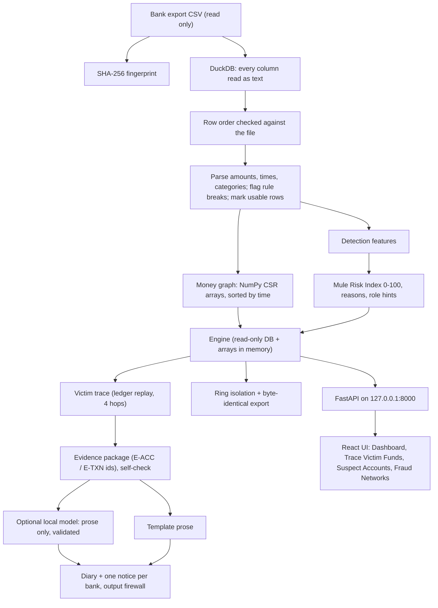

# Abhedya-Chakra: team guide

This is the guide for everyone on the team. It explains what the system does, how each part works, how to run and
test it, what has been measured, and where it is still weak. For the algorithm-level detail (every formula, parameter
and edge case) see [`HOW_IT_WORKS.md`](HOW_IT_WORKS.md); this guide links to its sections where useful.

State described: commit `cfd1052` (2 Oct 2026). Where this guide and older documents disagree, this guide is newer:
the UI section (10.5) and the test counts in `HOW_IT_WORKS.md` predate the last two rounds of work.

## Contents

1. [What we built, in one page](#1-what-we-built-in-one-page)
2. [Run it](#2-run-it)
3. [The big picture](#3-the-big-picture)
4. [Repository map](#4-repository-map)
5. [Ingest: from CSV to clean tables](#5-ingest-from-csv-to-clean-tables)
6. [The money graph](#6-the-money-graph)
7. [Detection: the Mule Risk Index](#7-detection-the-mule-risk-index)
8. [The victim trace](#8-the-victim-trace)
9. [Ring isolation and export](#9-ring-isolation-and-export)
10. [Evidence, documents and the AI guardrails](#10-evidence-documents-and-the-ai-guardrails)
11. [Saved cases (datasets)](#11-saved-cases-datasets)
12. [Data in use and file integrity](#12-data-in-use-and-file-integrity)
13. [The user interface](#13-the-user-interface)
14. [API reference](#14-api-reference)
15. [Files on disk](#15-files-on-disk)
16. [Testing](#16-testing)
17. [Measured results](#17-measured-results)
18. [Comparison with the team engine (VoidHacks-8-O repo)](#18-comparison-with-the-team-engine-voidhacks-8-o-repo)
19. [Known limitations](#19-known-limitations)
20. [Working on the code](#20-working-on-the-code)
21. [Demo script for the jury](#21-demo-script-for-the-jury)
22. [Glossary](#22-glossary)

---

## 1. What we built, in one page

Abhedya-Chakra is an **offline money-mule investigation workstation** for the Indore Police / 1930 Cyber Cell problem
statement (Void Hacks 8.0). One command loads a bank transaction export (the official file has 2,000,000 rows) and
opens a local web app at `http://127.0.0.1:8000`. Nothing leaves the machine.

What an officer can do with it:

| Task | How the system does it |
|---|---|
| Load 2M rows | DuckDB reads the CSV in about 13 s; the full pipeline (load, check, graph, score) takes about 27 s. The file itself is never modified. |
| Find the mules | Every account gets a **Mule Risk Index** from 0 to 100 with named reasons. HIGH (70+) means flagged. |
| Trace a victim's money | From a victim account ID, the trace follows the stolen money forward in time, up to 4 hops, and says exactly which account holds how much. |
| See the whole syndicate | One click isolates the ring around any account (3D globe or strict columns) and exports the original rows. |
| Produce paperwork | A Section 192 BNSS case diary and one Sections 94 & 106 BNSS (91 & 102 CrPC) debit-hold notice per bank. Every figure is checked against the data before the documents are shown. |
| Prove the file is untouched | The file's SHA-256 fingerprint is taken at loading, shown in the sidebar and printed on every document; the CSV is never written. |

**Important design choices** (worth knowing before you touch anything):

- **No machine learning for detection or tracing.** Detection is explicit graph and time rules with fixed weights;
  the trace is an exact ledger replay. Every flag and every rupee on a trail can be explained line by line. The only
  model in the system is an optional local language model that writes three prose paragraphs of the diary, and it
  never sees or produces a fact (section 10).
- **The CSV is evidence.** It is read, hashed and never written. Bad rows are flagged, not fixed or dropped.
- **Money is integer paise everywhere.** No floating-point rupees, so totals always balance to the paisa.
- **One source of truth for data shapes:** `contracts/models.py` (pydantic). The UI mirrors it in `web/src/types.ts`
  and a test checks they agree.

How the jury scores (problem statement, section 5) and where we stand:

| Criterion | Weight | Our status on the official file |
|---|---|---|
| Blind victim query: exact L1 / L2 / L3 and live graph | 40 % | 300 / 300 victims traced exactly, about 4 ms each |
| Detection precision and recall | 30 % | 1,073 / 1,073 mules found, 0 false positives (P = R = 1.0) |
| Court-ready output | 20 % | Diary + per-bank notices, evidence self-check, output firewall, facts fingerprint |
| Engineering rigour | 10 % | 205 automated tests, browser tests, benchmarks, offline, one-command start |

Note: the statement says 1,500 mules, but the file contains 1,073. We do not pad the list.

---

## 2. Run it

### First time (Windows; use the D: drive for everything big)

```
cd D:\srijan-coders\Srijan-coders
python -m venv .venv
.venv\Scripts\activate
pip install -e .[dev]
cd web && npm install && npm run build && cd ..
python -m abhedya serve --data data\VoidHacks8_MuleAccount_2M_Transactions.csv
```

Open `http://127.0.0.1:8000`. `serve --data` ingests the file only if there is no database yet or the database was
built from a different file (checked by SHA-256). Later starts open in about a second.

The official CSV is not in git (287 MB, and it is evidence). Put it in `data/`. `data/sample.csv` (50,000 rows from
the organisers) is in git.

### Everyday commands

| Command | What it does |
|---|---|
| `python -m abhedya serve --data <csv>` | ingest if needed, then serve the app |
| `python -m abhedya serve` | serve whatever case was open last (or the newest saved case) |
| `python -m abhedya ingest --data <csv>` | load, check, index and score without serving |
| `python -m pytest` | all tests (browser tests need `pip install playwright` and Microsoft Edge) |
| `python -m eval.evaluate` | precision / recall / trace accuracy on the official file, writes `eval/report.md` |
| `python bench/run.py --runs 5` | 2M-row benchmarks, writes `bench/results.md` |
| `cd web && npm run dev` | UI with hot reload on `:5173` (proxies `/api` to `:8000`) |
| `cd web && npm run build` | rebuild the UI that the server serves |

### Optional: the local AI narrator

Install [Ollama](https://ollama.com) and run `ollama pull qwen2.5:3b`. Without it, the diary uses fixed templates and
says so. Nothing else depends on the model.

### Keeping the server running

The server is a normal process. If you start it from a tool or terminal that has a time limit, it stops when the
limit is reached. To keep it running, start it as its own process (on Windows: `Start-Process` with
`-WindowStyle Hidden`), or just keep a terminal open.

---

## 3. The big picture



In words:

1. **Ingest** turns the CSV into validated DuckDB tables without changing a byte of the file.
2. **Graph** builds compact time-sorted adjacency arrays of who paid whom.
3. **Detection** scores every account and explains each score.
4. The **engine** serves traces, rings, account lookups and documents through a local HTTP API.
5. The **UI** is a React single-page app that the same server hosts. It works with no internet.

---

## 4. Repository map

| Path | What lives there |
|---|---|
| `abhedya/cli.py` | `serve` and `ingest` commands |
| `abhedya/config.py` | every tunable constant (windows, thresholds, budgets, paths) |
| `abhedya/ingest/` | CSV loading, row-order check, parsing, data-quality rules (`validate.py`), pipeline (`pipeline.py`) |
| `abhedya/graph/build.py` | CSR money-graph arrays |
| `abhedya/graph/trace.py` | the victim trace (ledger replay) |
| `abhedya/graph/ring.py` | ring isolation |
| `abhedya/detect/` | features (`features.py`), score (`risk.py`), parameters (`params.py`), reason labels, exports |
| `abhedya/engine.py` | the `Engine` object every API route uses: trace, account, ring, risk lookups |
| `abhedya/evidence/` | evidence package and its self-check |
| `abhedya/docs/` | Jinja2 templates and rendering of the diary and notices, output firewall |
| `abhedya/ai/` | optional narrator: prompt facts, Ollama client, validator, template fallback |
| `abhedya/datasets.py` | saved cases: upload, background analysis, switching, removal |
| `abhedya/api/` | FastAPI app and routes (`routes_trace`, `routes_risk`, `routes_docs`, `routes_datasets`, `routes_evidence`) |
| `abhedya/audit/log.py` | append-only audit log and file hashing |
| `contracts/models.py` | pydantic models for everything that crosses a boundary |
| `web/src/` | the UI (React 19, Vite 8, TypeScript 6) |
| `tests/` | all automated tests; `tests/trace_reference.py` is the plain trace the fast one must equal |
| `eval/` | ground truth for the official file and the evaluator (the only code allowed to know how the data was generated) |
| `bench/` | performance benchmarks and the live-model check |
| `reports/` | readiness report, test matrix, adversarial results, research notes |
| `docs/` | this guide and the engine walkthrough |

Local only, not in git yet: `tools/testgen/` (our out-of-sample data generator), `tools/external/` and
`tools/external_eval.py` (converters and evaluator for public datasets), `reports/external_eval/`, `plan/`. The
engine comparison harness lives outside the repo in `D:\srijan-coders\compare\`.

---

## 5. Ingest: from CSV to clean tables

Entry point: `run_ingest()` in `abhedya/ingest/pipeline.py`. Details: `HOW_IT_WORKS.md` section 3.

| Stage | What happens | Why |
|---|---|---|
| `hash` | SHA-256 of the whole file | identifies the evidence; shown in the sidebar and on every document |
| `load_csv` | DuckDB `read_csv` with **every column as text** into `txn_raw` | a malformed value can never stop the load or silently become NULL |
| `verify_order` | the database row order is compared with an independent RFC 4180 record reader | `txn_idx` (row number) is the real primary key; transaction IDs are not unique |
| `account_map` | each account gets a dense integer id | compact arrays |
| `derive+validate` | one SQL statement parses amounts to paise, timestamps, payment mode, narration category, IP class, device class; attaches data-quality flags; marks `usable` rows | parse safely with `TRY_CAST`, keep the raw text next to every cleaned value |
| `dq_summary`, `account_table` | flag counts and per-account totals | diary data-quality notes, account panel |
| `graph_arrays` | CSR arrays cached as `.npy` | fast reload |
| `detect` | features and risk scores | section 7 |

**Data-quality flags** (14 rules in `abhedya/ingest/validate.py`): missing field, bad amount, amount precision,
bad timestamp, bad account ID, bad IFSC, duplicate transaction ID, RTGS below Rs 2,00,000, UPI above the Rs 1,00,000
P2P limit, IMPS above Rs 5,00,000, unknown mode, zero or negative amount, timestamp outside the 15-day window,
self-transfer. Rows are flagged and kept. Only rows that cannot move money (no amount, no time, no valid accounts)
are left out of the money graph (`usable = false`). **Flags never change a risk score.**

On the official file the checks flag RTGS-below-minimum, UPI-above-limit and duplicate transaction IDs.

---

## 6. The money graph

`abhedya/graph/build.py` stores the graph as **CSR (compressed sparse row)** arrays: one pointer array plus flat edge
arrays (`peer`, `ts`, `amt`, `txn`, `cat`), once for outgoing and once for incoming edges. Each account's edges are
one contiguous slice, sorted by `(timestamp, row number)`, so an account's timeline is a slice and time windows are a
binary search. The arrays are cached on disk per input hash and load in well under a second.

---

## 7. Detection: the Mule Risk Index

Entry point: `detect.run()` in `abhedya/detect/__init__.py`. Details: `HOW_IT_WORKS.md` section 5.

### 7.1 The signals

Each signal comes straight from the problem statement:

| Signal | Meaning | Statement source |
|---|---|---|
| `pt` (pass-through) | share of incoming money passed on 3-15 minutes after it arrived, measured per account with lot matching | ">= 90 % dispersed within 3 to 15 minutes" |
| `episodes` | inflows followed within 15 minutes by payments to 3-7 distinct receivers | L2 "slicing into 3-7 accounts" |
| `burst`, `drain` | many distinct senders within 60 minutes, then the account emptied within 15 minutes | L1 fan-in |
| `cycle` | the same ring of 3-5 accounts closing at least twice within 24 hours (each hop within 20 % of the previous) | "cyclical smurfing" |
| `term_out`, `term_in`, `term_in_anom` | sending or receiving through wallet / crypto P2P channels, stronger when the sender used a script device or a foreign-proxy IP | L3 identifiers |
| `script`, `foreign` | the account's own payments from `Web_Emulator` / `Linux_Script` or 185.x / 194.x IPs | L3 identifiers |
| network | share of money exchanged with accounts that pass 1 already scored 50+ | ring membership |

### 7.2 Turning signals into one score

1. Signals are grouped, and each group takes its strongest signal, so correlated signals do not count twice:
   G1 velocity (weight 0.60), G2 topology (0.45), G3 channel (0.55), G4 network (0.40).
2. **Noisy-OR:** `score = 100 x (1 - product over groups of (1 - weight x signal))`. Each group can only raise the
   score.
3. **Floors:** patterns the statement names outright set a minimum, for example a strict pass-through of 90 % or more
   on at least 2 outflows floors the score at 70.
4. **Two passes:** pass 1 without the network group; accounts at 50+ become suspects; pass 2 adds the network group.
5. **Bands:** HIGH at 70 or more (flagged), MEDIUM 40-69, LOW below 40.

Each account gets **reason codes** (for example `PT_STRICT:0.98`, `FANOUT_EPISODES:3`) ordered by contribution, and a
**role hint** (L1, L2 or L3) describing its behaviour. The trace assigns roles independently, from the actual money
path.

The weights are set by hand, not fitted, so nothing was "trained on" the official file. On the official file the
lowest mule scores 73 and the highest other account 46: a 27-point gap.

---

## 8. The victim trace

Entry point: `Engine.trace()` in `abhedya/engine.py`, which calls `trace_core()` in `abhedya/graph/trace.py`.
Details: `HOW_IT_WORKS.md` section 6. This is the part the jury tests most (40 %), so it is worth understanding well.

### 8.1 The idea: follow parcels of money, not totals

Every account on the trail holds **lots**: parcels of money with an arrival time and an origin. A lot is either
**tainted** (the victim's money) or **clean** (anything else the account received). When an account sends money, the
trace decides which lots that payment spends, using three rules in order:

| Order | Rule | Picks | Why |
|---|---|---|---|
| 1 | `window` | lots that arrived 3-15 minutes before the payment | the statement's pass-through definition |
| 2 | `amount_match` | an inflow of which this payment passes on 90-100 % (and that is still at least 90 % unspent) | ">= 90 % of incoming funds" |
| 3 | `oldest` | the holder's **own money first**, then the victim's money, each oldest first | the lowest-intermediate-balance rule courts use: an account holder is presumed to spend their own money before stolen money |

The tainted part of each payment moves to the receiver as a new tainted lot one hop further. The trace stops at 4 hops
and at cash-out receivers (wallet / crypto P2P), which are L3.

All payments of all accounts are processed in **one global time order** (a heap keyed by timestamp and row number), so
money can only be spent after it arrived. Before an account's first tainted lot, its own ledger is replayed so its
clean balance is real.

Roles come from the path: first reached at hop 1 is **L1**, receiver of a cash-out is **L3**, everyone else on the trail
is **L2**. Every paisa is conserved: money held on the trail plus money that came back to the victim equals the loss.

### 8.2 A small example (hand-made, from `tests/test_trace.py`)

| Time | Transfer | What the trace does |
|---|---|---|
| 10:00 | Victim SBIN..01 pays HDFC..02 Rs 1,000 | seed: Rs 1,000 tainted lot at HDFC (hop 1, L1) |
| 10:05 | HDFC..02 pays ICIC..03 Rs 600 | the lot is 5 minutes old: `window` rule, Rs 600 tainted to ICIC (L2) |
| 10:08 | HDFC..02 pays AXIS..04 Rs 380 | `window` again: Rs 380 to AXIS (L2) |
| 11:00 | ICIC..03 pays PYTM..05 Rs 580 via a crypto wallet | 55 minutes is outside the window, but Rs 580 is 97 % of the Rs 600 inflow: `amount_match`; PYTM is a cash-out receiver (L3) |

Money still held: HDFC Rs 20, ICIC Rs 20, AXIS Rs 380, PYTM Rs 580. Total Rs 1,000: nothing lost or invented.

### 8.3 What counts as the loss (seeds)

- If the officer chose the disputed transfers ("Which payments did the victim report?" on the trace page, or `seed_txn` in the API), only
  those are traced.
- Otherwise the default is the victim's transfers to accounts scored **40 or more** (MEDIUM or HIGH). The first trace
  warning says so ("Traced the N of M outgoing transfers..."). If none qualify, all outgoing transfers are traced.
  This keeps a victim's ordinary bills and shopping out of the trail. On the official file every victim pays only its
  L1, so nothing changes there.

### 8.4 Speed

The trace replays ledgers in Python, so the cost is the number of ledger entries it touches. Three measures keep it
fast; the first is exact, the third is a deliberate limit:

1. **Indexed lot books (exact).** Each account's lots are indexed by arrival time (binary search for the window
   rule), by amount bucket (the amount rule only looks within 10 %), and by a pointer past spent money (the oldest
   rule). Inflows that no later payment could ever pick by window or amount are only ever spent as the holder's
   balance, so runs of them are kept as one lot. Replay starts after the last moment the account's own balance was
   exactly zero. `tests/trace_reference.py` keeps the plain version, and tests check the fast version gives
   **identical** edges, amounts, holdings and warnings (all 300 sample victims plus a dense random test world).
2. **Default seeds** (section 8.3): fewer, more relevant starting transfers.
3. **Busy-account budget** (`config.TRACE_MAX_LEDGER = 60_000` ledger entries per trace). If the money reaches a very
   busy account after the budget is used, it is shown as **held there** and a warning names the account. The budget
   counts entries, not seconds, so the same data always gives the same trail (important for evidence). It never
   triggers on the official file.

Measured (same machine, same victims):

| Dataset | Before: median / worst | Now: median / worst |
|---|---|---|
| Official 2M | 3.6 ms / 6 ms | 4 ms / 27 ms |
| `sample.csv` 50k | 3.4 ms / 47 ms | 4 ms / 25 ms |
| Generated 50k | 176 ms / 240 ms | 72 ms / 249 ms |
| Generated 500k | 1.8 s / 2.4 s | 0.24 s / 0.73 s |
| Generated 2M | 8.2 s / 11.7 s | 0.20 s / 0.26 s |

Trade-off: on the busiest generated data, the trail found shrinks where money stops at a busy account (reach on the
generated 500k set 81 % to 71 %, on the generated 2M set 90 % to 56 %). Raise `TRACE_MAX_LEDGER` for more reach, lower
it for more speed.

### 8.5 Warnings the trace can give

- several outgoing transfers treated as the loss, or which subset was chosen automatically;
- money that came back to the victim;
- payments in the same second ordered by file row;
- **ambiguity:** a payment that could be funded by this victim's money or by other money that arrived the same way
  (for example two victims within 15 minutes). Those accounts should be reviewed before freezing;
- very busy accounts not followed further (budget).

---

## 9. Ring isolation and export

`Engine.ring()` (`abhedya/graph/ring.py`, details in `HOW_IT_WORKS.md` section 7):

1. Suspects are all HIGH accounts.
2. A breadth-first search from the chosen account follows money in both directions, but only between suspects,
   optionally inside a time window.
3. Money entering the ring from non-suspects marks the victims.
4. The export is a ZIP with `transactions.csv` (the **original bytes** of every ring row, copied from the source
   file), `members.csv` and `manifest.json` (hashes, counts, source SHA-256). A test checks the bytes are identical
   to the source.

The official file's syndicate is one ring of 1,373 accounts (1,073 mules plus 300 victims) and 2,954 links.

---

## 10. Evidence, documents and the AI guardrails

Details: `HOW_IT_WORKS.md` sections 8 and 9.

### 10.1 Evidence package

`build_evidence()` turns a trace into an `Evidence` object: accounts as `E-ACC-001` (always the victim),
`E-ACC-002`...; transfers as `E-TXN-0001`... It includes the freeze list, the trace warnings and data-quality notes
for the trail's own transfers. Three fingerprints are recorded: the data SHA-256, the trace SHA-256 and the **facts
fingerprint** (identical with the AI on or off; printed on every page footer).

`verify_evidence()` refuses to render if anything is inconsistent: duplicate IDs, unknown accounts on a transfer,
attributed more than the transfer, held more than received, seeds not adding up to the loss, money not balancing.

### 10.2 Documents

Jinja2 templates in `abhedya/docs/templates/` (autoescaping on, a missing value is an error):

- **Letterhead:** Madhya Pradesh Police, Indore; the police station; Police Commissionerate · National Cyber Crime
  Helpline 1930.
- **Case diary (Section 192 BNSS, 2023):** particulars (FIR / Case No., NCRP / 1930 Complaint No., sections of law,
  Investigating Officer with rank, date). Blank fields print a line to fill in by hand. Then six numbered sections:
  1. complainant account and loss;
  2. investigation narrative, with its source stated;
  3. chronological money trail;
  4. layer-wise accounts;
  5. accounts recommended for immediate debit freeze;
  6. further action proposed, including the trace warnings and data-quality notes as points to verify.

  Then the IO signature block.
- **One notice per bank** under **Sections 94 & 106 BNSS, 2023 (corresponding to Sections 91 & 102 CrPC)**,
  addressed to the bank's nodal officer:
  - it requests a **debit hold limited to the amount shown** (not a full freeze);
  - it lists each disputed credit, and asks for KYC, statements, linked accounts and device / IP logs.
- **In the UI ("Case documents" dialog):**
  - Case particulars on the left (the local AI switch says whether the model is installed).
  - A **Verification passed / failed** box showing how many accounts, IFSCs, transaction IDs and amounts the firewall
    checked, how many failed, and the evidence fingerprint.
  - Tabs for the diary, all notices and each bank (with its hold amount); Save HTML; Print / PDF.
  - The API returns these in `CaseOutput.notices` and `CaseOutput.verification`; `GET /api/docs/llm` reports the
    model.

### 10.3 The output firewall

After rendering, every document is scanned for account numbers, IFSCs, transaction IDs, evidence IDs and rupee
figures. Anything not in this case's evidence (or not produced by the `inr` formatter in this render) stops the
whole case: nothing is written.

### 10.4 The optional AI narrator

- Writes only three paragraphs: summary, modus operandi, recommendation.
- Sees only evidence IDs, roles, bank names, layer counts and timing in words. It **never** sees account numbers,
  amounts, timestamps, narrations, IPs or device strings (those are the fields a fraudster can write into, so this is
  the main defence against prompt injection).
- Its reply is bounded by a JSON schema, then checked by `abhedya/ai/validator.py`: no 4+ digit numbers, money words,
  account or IFSC or transaction IDs, IPs, dates, guilt words, unknown evidence IDs, wrong roles, wrong banks or
  non-English text. Two attempts, then the template takes over.
- Measured with `qwen2.5:3b`: 8 of 10 replies accepted, about 15 s each. Documents without it take about 40 ms.

So the anti-hallucination guarantee is about **facts**: every number and identifier in a document comes from the
evidence. The prose can still be clumsy, which is why the diary marks AI text as "verify before signing".

---

## 11. Saved cases (datasets)

`abhedya/datasets.py` and `/api/datasets`. Investigators can analyse any export with Upload new file on the Dashboard.

- **Upload:** the file streams to disk while being hashed (1 GB limit, header checked for the 11 required columns),
  then is stored by hash in `data/datasets/<first 12 hex of SHA-256>/` as `source.csv` with its own `case.duckdb`.
  The same file uploaded twice opens the existing case.
- **Analysis** runs in a background thread with live per-stage progress (the upload dialog shows each stage's real
  timing). A 50,000-row file is ready in about 3 s.
- **Switching** cases swaps the engine the API uses. The open case is remembered in `data/datasets/active.txt` and
  reopened after a restart.
- **Removing** a case (Dashboard, Upload new file, Saved cases, Remove, then confirm) deletes its database, graph cache and stored copy. For
  the official case only what was built from the file is deleted; the original CSV stays, and a marker
  (`official.removed`) stops `serve --data` from rebuilding it. Removing the open case opens another; the last
  remaining case cannot be removed.

---

## 12. Data in use and file integrity

The Evidence tab was removed after the judges' feedback (too much for an officer). What remains:
- **Fingerprint:** the file's SHA-256 is taken at loading, shown in the sidebar footer, and printed on every
  document's footer with the facts fingerprint.
- **Data in use:** there is no separate data page. The Dashboard's top-right card names the dataset every report
  uses (switchable) with its transactions and accounts; Upload new file opens the analyse dialog with live stage
  timings and the saved cases (open, remove).
- **Data-quality flags:** still computed for every row. They appear in the diary's points to verify and in the
  account panel.

---

## 13. The user interface

React 19 + Vite 8 + TypeScript 6, served by the same FastAPI process. Every screen has a shareable address
(`web/src/route.ts`), so Back / Forward and pasted links work.

The left sidebar has four screens, each in English with the Hindi name beneath. Pages scroll normally; only the
masthead and sidebar stay put.

| Screen | Address | What it shows |
|---|---|---|
| Dashboard (डैशबोर्ड) | `#overview` (default; old `#home` / `#data` go here) | data in use for every report, with Upload new file; **Where the victims' money went** (victims → collectors → distributors → cash-out with amounts and timings, can still be frozen by layer, accounts checked, banks / linked network / circular routing); why accounts were flagged; suspects by bank; daily activity; victims found |
| Trace Victim Funds (पीड़ित राशि का पता लगाएँ) | `#trace=ACCOUNT` | one scrolling report: select the victim; summary sentence and journey strip (collector, distributors, cash-out, can still be frozen); four insight cards; **How the money moved** (money-trail tree; pointing at a box shows received / passed on / still holds; timeline whose steps fit the trail, with Transfer by transfer; Replay); collector's first minutes (payment by payment) and the trace record; accounts to freeze; transactions in the trail |
| (several victims) | `#traceall=A,B,C` | paste the complainants' IDs and Trace all: totals, complaints that may be clubbed (shared mule accounts), one column per victim by layer, combined CSV, documents per victim |
| Suspect Accounts (संदिग्ध खाते) | `#flagged?role=&bank=&reason=` | the flagged list with role badges and reasons in words, filters, account panel, CSV downloads |
| Fraud Networks (धोखाधड़ी नेटवर्क) | `#ring` / `#ring=ACCOUNT` | start list of collectors; then **Money flow** (default: who paid in and where the money went, step by step, sized to fit the window; point at an account for received / passed on / kept; click to re-centre), **Trail** (one victim's money through the account, drawn like the trace tree; a picker for every victim whose money reached it; point at a box for received / passed on / still holds) or the **Globe** toggle for the whole network; layer filters, time slider, ZIP export |

Things worth knowing:

- **Look:** a government frame (tricolour strip, police masthead with crest, IST clock, "For official use only",
  navy sidebar) around quiet ruled pages.
  - **Day and Night** themes come from the masthead switch; `?theme=dark` forces one.
  - Fonts are Noto Sans and Noto Sans Devanagari, with IBM Plex Mono for account numbers. All are offline.
  - Details are in `DESIGN.md`.
- **Plain words:** "Collector (Layer 1)", "can still be frozen", "+4 min after the victim's payment". Reason codes and
  engine warnings are shown as sentences.
- **Timeline:** play / pause, step size (1 min to 1 day per step, or automatic), playback rate 1x to 2x, previous / next
  transfer, 15-day switch. On the trace page it sits with the money-trail tree and drives the tree and the
  over-time chart.
- **Layer colours** are colour-blind checked in both themes: L1 orange, L2 purple, L3 teal, victim blue; green for
  money that can still be frozen; red only for money at risk and warnings.
- **Motion** follows Emil Kowalski's rules: ease-out, under 300 ms, transform and opacity only, and everything off
  under `prefers-reduced-motion`.
- **Performance:** the trace page is ready in well under a second on the 2M file. The 1,373-account globe renders at
  60+ fps because the whole ring is drawn as one point cloud and one line set.

---

## 14. API reference

All routes are under `/api`. Money is integer paise in JSON. Unknown accounts give 404, a missing database 503.

| Method | Path | Purpose |
|---|---|---|
| GET | `/api/health` | liveness and data SHA-256 |
| GET | `/api/stats`, `/api/dq/summary` | rows, accounts, flag counts, source hash, stage timings |
| GET | `/api/overview` | aggregates for the Overview screen (cached) |
| GET | `/api/flow` | where the victims' money went: every identified victim traced once, summed per layer, with what can still be frozen (cached; ~0.3 s on the official file) |
| GET | `/api/search?q=` | account prefix search |
| GET | `/api/trace/{victim}?max_hops=&seed_txn=` | the trace (`seed_txn` repeatable = disputed transfers) |
| GET | `/api/account/{acct}` | totals, counterparties, mode / device / IP histograms, flags, risk |
| GET | `/api/account/{acct}/txns?limit=&offset=` | an account's transactions in time order |
| GET | `/api/txns?idx=` | transactions by row number (up to 500) |
| GET | `/api/ring/{acct}?t_from=&t_to=` | the ring; `/export.zip` for the ZIP |
| GET | `/api/risk/top`, `/api/risk/{acct}`, `/api/risk/reasons` | scores and reason labels |
| GET | `/api/risk/{acct}/explain` | the score check by check: points per check, how they combine, any named-pattern minimum |
| GET | `/api/victims` | candidate victims (paid flagged L1 accounts) |
| GET | `/api/export/flagged.csv`, `/api/export/ranked.csv` | exports |
| POST | `/api/docs/{victim}` | build evidence and documents; body has FIR / NCRP numbers, station, IO, AI on/off, disputed transfers |
| GET | `/api/docs/{case_id}/{file}` | a written document (FIR draft, case diary, notices, evidence, manifest) |
| GET | `/api/docs/{case_id}/notices.zip` | every bank's freeze notice for the case, one file per bank |
| GET | `/api/docs/{case_id}/case_file.zip` | the complete case file: every document, evidence, manifest, money trail CSV |
| GET / POST / DELETE | `/api/datasets`, `/api/datasets/{id}/progress`, `/activate` | saved cases (upload is a raw POST body) |
| GET | `/api/docs/llm` | whether the local AI model is installed |

---

## 15. Files on disk

| Path | Contents | In git? |
|---|---|---|
| `data/VoidHacks8_MuleAccount_2M_Transactions.csv` | the official file (evidence) | no |
| `data/sample.csv` | the organisers' 50k sample | yes |
| `data/case.duckdb`, `data/cache/<hash>/` | database and graph arrays built from the official file | no |
| `data/datasets/<id>/` | a saved case: `source.csv`, `case.duckdb`, `meta.json`, `cache/`, `exports/` | no |
| `data/datasets/active.txt`, `official.removed` | open case; official-case removal marker | no |
| `data/audit.jsonl` | append-only audit log (loads, exports, documents, verifications) | no |
| `cases/<case_id>/` | written diary, notices, `evidence.json`, `manifest.json` | no |
| `web/dist/` | built UI | no (build it) |

---

## 16. Testing

`python -m pytest`: **205 passed, 5 skipped** at `cfd1052` (about 2 minutes).

| File | What it proves |
|---|---|
| `test_trace.py` | the 300 official-style victims exact; conservation and time order; split, residue, own-money-first, pro-rata, shared mule, hop limit, ambiguity; **fast trace identical to the reference** (sample + dense random world); budget; default seeds |
| `test_detect.py` | detection boundaries and traps (ordinary accounts stay LOW, one-off wallet top-up, back-and-forth); no generator knowledge inside the engine |
| `test_properties.py` | Hypothesis random worlds: score bounds, conservation, determinism, flags never change risk |
| `test_adversarial_shapes.py` | window edges at 179/180/181 and 899/900/901 s, ties, hubs, cliques, long chains |
| `test_ingest.py`, `test_robustness.py` | row order, raw values kept, malformed files, BOM, CRLF, quoted newlines, hostile text, file untouched |
| `test_api.py` | routes, 404s, byte-identical ring export, saved cases (upload, switch, restart reopen, remove) |
| `test_docs.py`, `test_validator.py`, `test_llm_grounding.py` | documents, firewall, validator rules, 20 hostile model replies rejected, AI on / off gives identical facts |
| `test_security.py` | path traversal, injection-shaped IDs, resource limits, HTML escaping |
| `test_contract.py` | every TypeScript type matches its pydantic model |
| `test_e2e_workflows.py` | the real UI in headless Microsoft Edge: every main workflow, sidebar, Day / Night, trace tree and playback, case documents, uploads, globe |

**Ground truth without leakage:** `eval/ground_truth.py` is the only code that may use how the official data was
generated. The engine never imports it, and a test scans `abhedya/` for generator strings and fails on any hit.

---

## 17. Measured results

Machine: Intel i5-10300H (4 cores / 8 threads), 16 GB RAM, Windows 11, Python 3.12, DuckDB 1.5. This matches the
statement's "16 GB laptop".

### 17.1 Official file (the jury's data)

| Measure | Result | Target |
|---|---|---|
| Load + index 2M rows | 12.7 s (full pipeline incl. detection 26.7 s), peak 1.4 GB | <= 60 s |
| Detection | precision 1.0000, recall 1.0000 (1,073 TP, 0 FP, 0 FN) | 1,500 claimed; 1,073 present |
| Role hints | L1 / L2 / L3 all correct | |
| Victim traces | 300 / 300 exact layers and transactions | blind test |
| Trace latency | median 4 ms, worst 27 ms | <= 2 s |
| Documents (no AI) | about 40 ms | |
| Trace screen ready in the browser | about 0.4 s | sub-second |

### 17.2 Data the engine never saw

| Dataset | What it is | Precision | Recall | F1 | Accuracy |
|---|---|---|---|---|---|
| Organisers' `sample.csv` | 50k rows, same injected chains | 1.000 | 1.000 | 1.000 | 1.000 |
| Generated 50k | our generator, seed 101 | 0.72 | 0.83 | 0.77 | 0.94 |
| Generated 500k | seed 202 | 0.54 | 0.82 | 0.65 | 0.95 |
| Generated 500k hold-out wording | seed 404, unseen narration phrasing | 0.93 | 0.50 | 0.65 | 0.97 |
| Generated 2M | seed 303 | 0.50 | 0.78 | 0.61 | 0.94 |
| AMLSim (3 public sets) | general laundering simulator | flags nothing | 0 | 0 | 0.91-0.95 |
| Adversarial suites (`reports/`) | typologies from FBI / Europol / FinCEN / AMLworld | 91.5-91.9 % of clear-cut mules found; 4 false positives in 18,839 legitimate accounts | | | |

How to read this: the generated worlds include legitimate look-alikes (aggregators, payroll, crypto investors) and
mules with weak signals, so they are much harder than the official file. AMLSim spreads activity over months with no
wallet, proxy or script signals; it is outside what the statement describes. Accuracy looks high everywhere because
most accounts are legitimate, so quote precision and recall.

---

## 18. Comparison with the team engine (VoidHacks-8-O repo)

On 2 Oct 2026 we ran the team engine from `github.com/VoidHacks-8-O/Srijan-Coders` (rules plus a LightGBM / XGBoost
model, flag at 40) against ours, each in its own process with its own environment, scored by one shared scorer with
the same truth. Harness: `D:\srijan-coders\compare\`.

| Dataset | Ours P / R / F1 | Team P / R / F1 | Notes |
|---|---|---|---|
| Official 2M | 1.00 / 1.00 / 1.00 | 1.00 / 1.00 / 1.00 | team model was trained on this file, so its score is in-sample |
| Organisers' sample 50k | **1.00 / 1.00 / 1.00** | 0.56 / 1.00 / 0.72 | team flags 847 innocent accounts |
| Generated 50k | **0.72 / 0.83 / 0.77** | 0.29 / 0.99 / 0.45 | |
| Generated 500k | **0.54 / 0.82 / 0.65** | 0.07 / 0.96 / 0.13 | team flags about 5,000 of 6,400 accounts |
| Generated 500k hold-out | **0.93 / 0.50 / 0.65** | 0.07 / 0.98 / 0.14 | |
| AMLSim (3 sets) | flags nothing | flags 8-9, about 6 wrong | both out of scope |

| Trace (blind victim test) | Ours | Team |
|---|---|---|
| Official: exact L1 / L2 / L3 | **300 / 300** | 299 / 300 |
| Generated data: share of the true trail found | 47-78 % | 28-36 % |
| Generated data: layer labels right | 76-85 % | 35-49 % |
| Latency (median) | 4 ms official; 70-240 ms generated | 0.7 ms official; 7-80 ms generated |

| Scale | Ours | Team |
|---|---|---|
| 2M official: load to ready | 26 s, 1.4 GB | 19 s, 2.6 GB |
| 500k generated | 6-7 s, 0.5 GB | 43-48 s, 3.5 GB |

Verdict: ours is the better engine for the jury. It ties on the official file for detection, edges the blind trace,
and is far more precise on every dataset it was not tuned on. The team engine's ML is fitted to the official file and
over-flags elsewhere. We took one idea from it: start the trace from the victim's transfers to suspicious accounts
(section 8.3). Caveats: the generated worlds come from our own generator, and we did not run the team's own synthetic
test set; traces on generated data used samples of 15-100 victims.

---

## 19. Known limitations

1. **Funnel accounts** (many depositors, then drained) are found only about 36 % of the time on independent data; a
   stricter rule caused false positives on the official file.
2. **Weak-signal mules:** a mule showing one indicator is flagged about 42 % of the time; a mule showing none cannot be
   told apart from an ordinary account by any statement-based method.
3. **Plain cash-out chains** without wallet / crypto wording are found about 25 % of the time.
4. **Legitimate look-alikes** (small payroll runs, wallet providers, aggregators) can score high; investigators must
   review them. This is why the default trace start uses MEDIUM+ accounts and the picker exists.
5. **Busy-account budget:** on data with collectors of 50,000+ transactions, the trail can stop at such an account
   (shown as held, with a warning).
6. **No untouched hold-out remains** for detection: the hold-out wording was used once to find a problem.
7. **Detection weights are hand-set,** not fitted. The official file is clean and synthetic; real exports will be
   noisier.
8. **The live AI narrator** is accepted 8 of 10 times and takes about 15 s; the template is always available.
9. **Not yet measured:** flushed OS file cache, Linux / macOS, machines with less than 16 GB RAM.
10. **Data assumptions:** bank names come from the 4-letter account prefix; timestamps are treated as UTC (only
    differences matter).

---

## 20. Working on the code

### Ground rules

- **Never modify the source CSV.** Ingest reads it; every export copies its original bytes.
- **Money is integer paise.** Use the `inr` formatter (Python) or `inr()` in `web/src/format.ts` to display it.
- **Change a data shape in `contracts/models.py` first,** then mirror it in `web/src/types.ts`; `test_contract.py`
  fails until they agree.
- **No facts from the model.** Anything that ends up in a document must come from the evidence package.
- **Keep the trace exact.** If you change `abhedya/graph/trace.py`, run `tests/test_trace.py`; if you change the
  attribution rules on purpose, change `tests/trace_reference.py` the same way so the equivalence tests keep meaning
  something.
- **Put big files on the D: drive** (datasets, model caches, virtual environments).
- **Commit messages** describe the change in plain words; no tool-generated trailer lines.

### Common tasks

| Task | Where | Then |
|---|---|---|
| Tune a detection weight or threshold | `abhedya/detect/params.py` | `python -m eval.evaluate` and `pytest tests/test_detect.py`; check the official file stays 1,073 / 0 |
| Add a data-quality rule | `DQ_RULES` and `RULE_TEXT` in `abhedya/ingest/validate.py` | re-ingest; the diary's points to verify pick it up automatically |
| Change trace speed vs reach | `TRACE_MAX_LEDGER`, `SEED_MIN_SCORE` in `abhedya/config.py` | `pytest tests/test_trace.py` |
| Add an API route | a router in `abhedya/api/`, models in `contracts/models.py`, types in `web/src/types.ts`, client in `web/src/api.ts` | a test in `tests/test_api.py` |
| Change UI wording for one look | `web/src/copy.ts` | `npm run build`, browser tests |
| Change colours / fonts / motion | `web/src/index.css` (tokens), `web/src/ui.css` | keep the colour-blind checks in `DESIGN.md` |
| Measure on new data | `python -m abhedya ingest --data <csv>` or Upload new file on the Dashboard | for labelled data use `tools/external_eval.py` (local) |

---

## 21. Demo script for the jury

1. **Dashboard:** the headline sentence (1,073 accounts behave like mules; 300 victims), the clean gap at 70, roles
   129 / 559 / 385, suspects by bank. Mention load time and that nothing leaves the laptop.
2. **Blind victim test:** type the judge's victim ID in the masthead search (or on Trace Victim Funds) and press Enter.
   - Read the summary sentence and the journey strip: 1 collector, 5 distributors, 5 cash-out, amount that can still
     be frozen.
   - Walk the four insight cards, then **How the money moved**: press Replay, or Play on the timeline, to show the money
     moving transfer by transfer. Point at a box to follow its path, and click it for the account.
   - Show the collector's first 15 minutes and the trace record (the method in plain words).
   - If the judges give several IDs: Trace Victim Funds, **Several victims**, paste them all (or **Paste 5 random victims** for a demo), **Trace all**. Show the
     columns side by side, the accounts they share ("these complaints may be clubbed") and the combined CSV.
3. **Police reports & freeze notices** (top right on the trace, also on Fraud Networks; drafts for the officer's verification):
   - fill FIR / IO / rank;
   - show the Verification passed box (figures checked, fingerprint);
   - open the diary and one bank's notice; Print / PDF.

   Mention the AI can be off with no loss.
4. **Fraud Networks:** View fraud network from the trace. Show the money flow around the collector, then Trail for one victim's path (switch victims in the picker),
   point at a box for what it kept, switch to Globe for the whole network, and export the ZIP (original rows, byte-identical).
5. **Suspect Accounts:** filter by role or bank; open an account to show the reasons in words.
6. **Robustness (if asked):** on the Dashboard, click Upload new file, drop `sample.csv` and show it analysed live in about 3 seconds.
7. **Night mode (if asked):** the Day / Night switch in the masthead.

---

## 22. Glossary

| Term | Meaning |
|---|---|
| L1 / L2 / L3 | collector / distributor / cash-out mule; in the trace: first hop / middle / receiver of a cash-out |
| Pass-through | money leaving soon after it arrived; statement: >= 90 % within 3-15 minutes |
| Fan-in / fan-out | many senders into one account / one account paying many receivers |
| Cyclical smurfing | money going round the same ring repeatedly, with a cut at each hop |
| Lot | a parcel of money in an account with arrival time and origin, tainted or clean |
| Seed | a victim transfer treated as the reported loss |
| Freeze candidate | an account on the trail still holding at least Rs 1 of the victim's money |
| Noisy-OR | combining independent evidence: `1 - product(1 - w x s)`; each piece only raises the result |
| CSR | compressed sparse row: a pointer array plus flat edge arrays; a node's edges are one slice |
| Evidence ID | `E-ACC-001`, `E-TXN-0001`: stable labels used by documents and the model instead of raw values |
| Facts fingerprint | SHA-256 of all facts in a case; identical with the AI on or off |
| Paise | 1/100 rupee; all money is stored as integer paise |
